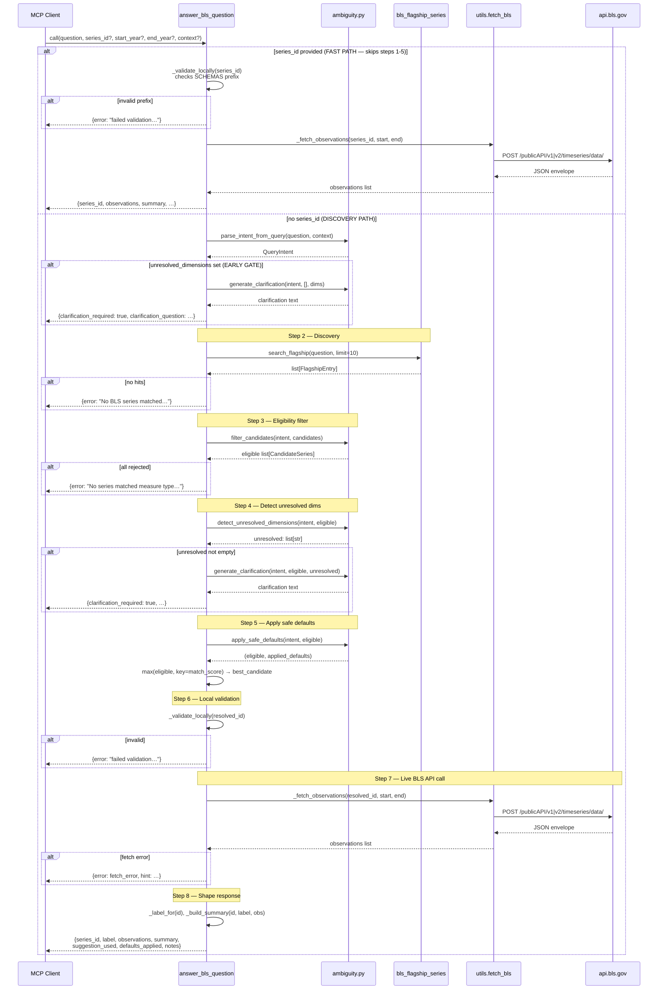
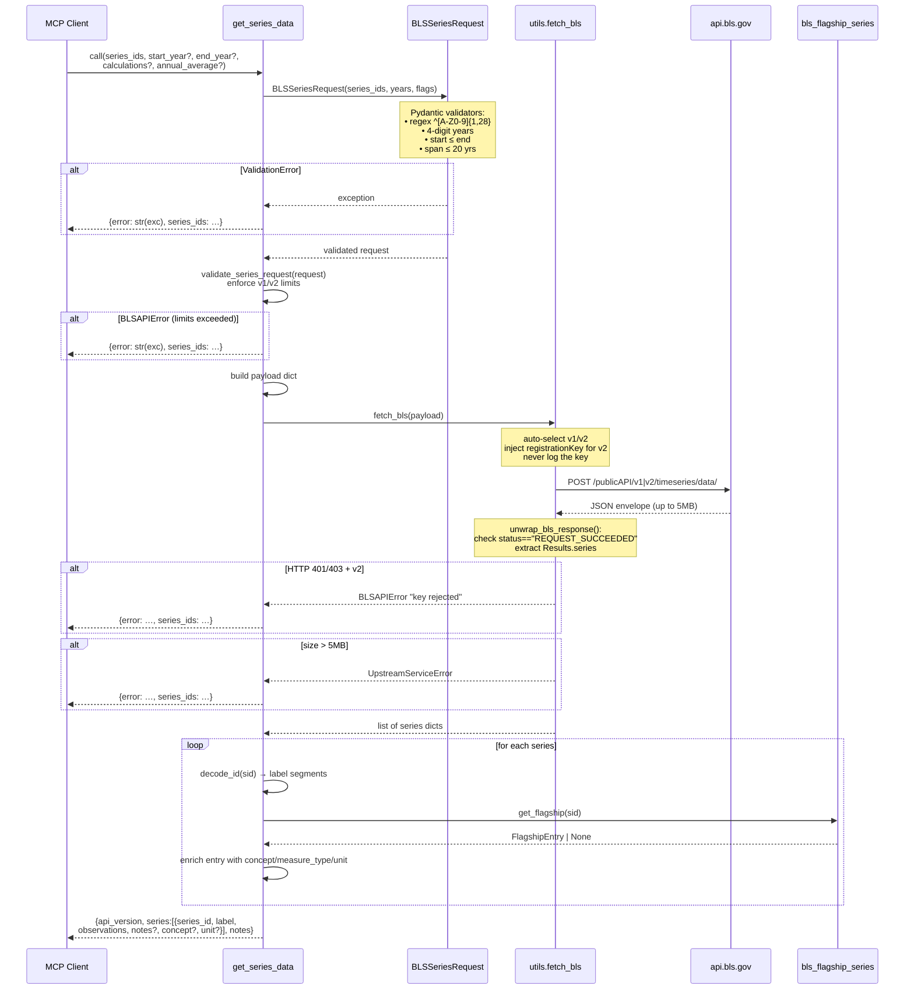
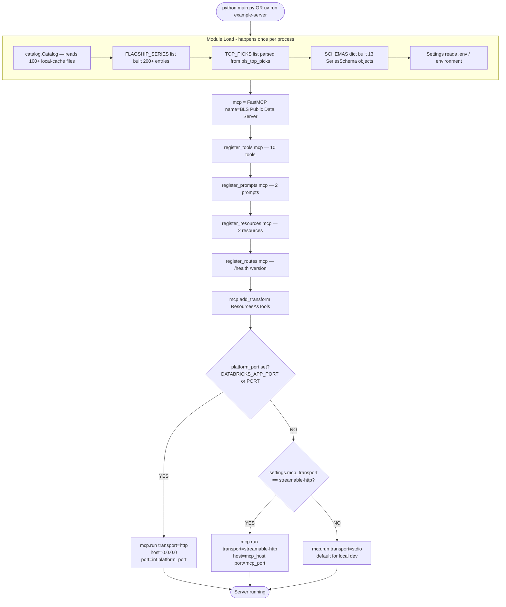
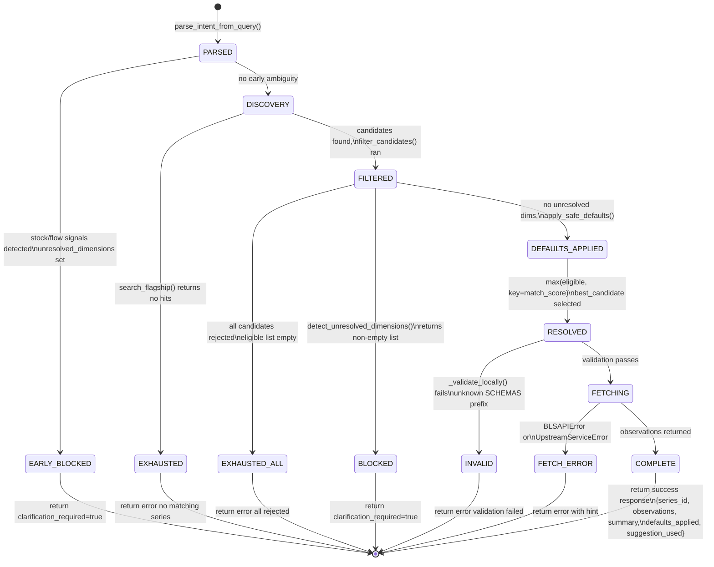

# BLS MCP Server — Architecture & UML Diagrams

> Generated from full source-code inspection of the GSA MCP Hackathon repository.
> All diagrams are based on actual code paths, import chains, and runtime behaviour —
> not on comments or assumptions.

---

## Table of Contents

1. [High-Level System Architecture](#1-high-level-system-architecture)
2. [Package / Module Diagram](#2-package--module-diagram)
3. [Class Diagrams — Core Domain](#3-class-diagrams--core-domain)
4. [Sequence Diagram — answer_bls_question Pipeline](#4-sequence-diagram--answer_bls_question-pipeline)
5. [Sequence Diagram — get_series_data Pipeline](#5-sequence-diagram--get_series_data-pipeline)
6. [Decision Flow — Ambiguity & Clarification Gate](#6-decision-flow--ambiguity--clarification-gate)
7. [Decision Flow — API Version & Limit Selection](#7-decision-flow--api-version--limit-selection)
8. [Activity Diagram — Server Startup & Transport Selection](#8-activity-diagram--server-startup--transport-selection)
9. [State Diagram — QueryIntent Resolution](#9-state-diagram--queryintent-resolution)
10. [Data Flow Diagram — End-to-End](#10-data-flow-diagram--end-to-end)
11. [Eval Pipeline Architecture](#11-eval-pipeline-architecture)
12. [Business Decision & Control Flow Analysis](#12-business-decision--control-flow-analysis)

---

## 1. High-Level System Architecture

**Purpose:** Show all major components, service boundaries, external systems, and
communication paths.
**Confidence:** HIGH — derived from `app.py`, `config.py`, `Dockerfile`, `deploy/`.

```
┌─────────────────────────────────────────────────────────────────────────────┐
│                        MCP CLIENT LAYER                                     │
│  ┌──────────────┐  ┌────────────────────────┐  ┌─────────────────────────┐ │
│  │ Claude       │  │ IBM watsonx Orchestrate │  │ Any MCP-compliant       │ │
│  │ Desktop/Code │  │ (gsa_ds_bls_agent)      │  │ client (Zed, etc.)     │ │
│  └──────┬───────┘  └───────────┬────────────┘  └────────────┬────────────┘ │
└─────────┼─────────────────────┼─────────────────────────────┼──────────────┘
          │  stdio transport     │  streamable-HTTP /mcp       │
          ▼                      ▼                             ▼
┌─────────────────────────────────────────────────────────────────────────────┐
│                     BLS PUBLIC DATA MCP SERVER                              │
│  (FastMCP v2 · Python 3.11 · package: example_server)                      │
│                                                                             │
│  app.py — FastMCP instance + registration orchestrator                      │
│  Transports: stdio | streamable-http | http (PORT env auto-select)          │
│                                                                             │
│  ┌────────────┐  ┌──────────┐  ┌──────────────────┐  ┌──────────────────┐ │
│  │ tools/     │  │ prompts/ │  │ resources/       │  │ routes.py        │ │
│  │ (10 tools) │  │ (2)      │  │ (bls_surveys)    │  │ GET /health      │ │
│  │            │  │          │  │                  │  │ GET /version     │ │
│  └────────────┘  └──────────┘  └──────────────────┘  └──────────────────┘ │
│                                                                             │
│  CORE DOMAIN LAYER                                                          │
│  ┌──────────────┐  ┌─────────────────────┐  ┌──────────────────────────┐  │
│  │ ambiguity.py │  │ bls_series_schema.py│  │ bls_flagship_series.py   │  │
│  │ intent parse │  │ 13 survey schemas   │  │ FLAGSHIP_SERIES catalog  │  │
│  │ filter, gate │  │ decode/build_id     │  │ 200+ curated entries     │  │
│  └──────────────┘  └─────────────────────┘  └──────────────────────────┘  │
│  ┌──────────────┐  ┌─────────────────────┐  ┌──────────────────────────┐  │
│  │ catalog.py   │  │ models.py           │  │ config.py                │  │
│  │ Catalog      │  │ BLSSeriesRequest    │  │ Settings, API limits,    │  │
│  │ singleton    │  │ QueryIntent,        │  │ SEASONAL_DEFAULTS,       │  │
│  │ local TSV/FW │  │ CandidateSeries     │  │ feature flags            │  │
│  └──────────────┘  └─────────────────────┘  └──────────────────────────┘  │
│  ┌──────────────┐                                                           │
│  │ utils.py     │  fetch_bls(), unwrap_bls_response(),                      │
│  │              │  validate_series_request(), paginate()                    │
│  └──────────────┘                                                           │
│                                                                             │
│  LOCAL DATA STORE (bundled in package, read at import time)                 │
│  local-cache/: 100+ TSV & fixed-width reference files                       │
│  Surveys: SM, CE, LA, JT, CU, LN, PR, MP, CW, WP, EI, CI, PC,             │
│           BD, AP, NB, SU, QCEW                                              │
└─────────────────────────────────────────────────────────────────────────────┘
          │
          │  HTTPS POST  api.bls.gov/publicAPI/v1|v2/timeseries/data/
          ▼
┌───────────────────────────────────────┐
│  BLS Public Data API (External)       │
│  v1: 25 req/day, 25 series, 10yr range│
│  v2: 500 req/day, 50 series, 20yr     │
│  Auth: optional registrationKey       │
└───────────────────────────────────────┘

DEPLOYMENT TARGETS:
  • Local (stdio)       : Claude Desktop / Claude Code / Zed
  • IBM Code Engine     : Docker container, PORT=8080, streamable-HTTP
  • Databricks Apps     : DATABRICKS_APP_PORT env, HTTP transport
  • watsonx Orchestrate : registered as gsa_ds_bls_toolkit MCP toolkit
```

---

## 2. Package / Module Diagram

**Purpose:** Repository folders, Python packages, and their coupling relationships.
**Confidence:** HIGH — traced every `import` statement in every file.

```
src/example_server/           ← installable Python package
│
├── app.py                    ← ENTRY POINT. Imports & wires all submodules.
│                               Creates FastMCP instance; calls register_*.
│
├── config.py                 ← Settings (pydantic-settings). No imports from
│                               other server modules. Imported by: utils, app,
│                               tools/*.
│
├── models.py                 ← Pydantic/dataclass types only.
│                               Imports: config (SEASONAL_DEFAULTS).
│                               Imported by: ambiguity, utils, tools/*.
│
├── utils.py                  ← HTTP client helpers (httpx).
│                               Imports: config, models (TYPE_CHECKING only).
│                               Imported by: tools/get_series_data,
│                                            tools/answer_bls_question.
│
├── catalog.py                ← Catalog singleton. Reads local-cache/ at import.
│                               No imports from other server modules.
│                               Imported by: bls_series_schema (decode_id,
│                                            deferred), tools/lookup_*.
│
├── bls_series_schema.py      ← SeriesSchema/SeriesSegment + decode_id/build_id.
│                               Deferred import of catalog inside decode_id()
│                               to avoid circular import.
│                               Imported by: tools/build_series_id,
│                                            tools/decode_series_id,
│                                            tools/validate_series_id,
│                                            tools/get_series_data,
│                                            tools/get_series_metadata,
│                                            tools/answer_bls_question,
│                                            tools/suggest_series.
│
├── bls_flagship_series.py    ← FlagshipEntry dataclass + FLAGSHIP_SERIES list
│                               (SM/CE/LA/JT/CU/LN/PR/MP/CW/WP/EI/CI entries).
│                               search_flagship(), get_flagship().
│                               No other server imports.
│                               Imported by: ambiguity, tools/suggest_series,
│                                            tools/get_series_data,
│                                            tools/get_series_metadata,
│                                            tools/answer_bls_question,
│                                            resources/bls_surveys.
│
├── bls_top_picks.py          ← TopPickEntry + TOP_PICKS list.
│                               Reads local-cache/bls_top_picks.
│                               No imports from other server modules.
│                               Imported by: tests only.
│
├── ambiguity.py              ← Intent parsing, candidate filtering,
│                               clarification generation.
│                               Imports: models.
│                               Imported by: tools/answer_bls_question only.
│
├── routes.py                 ← /health, /version Starlette routes.
│                               Imports: example_server.__version__.
│
├── tools/                    ← One file per MCP tool.
│   ├── __init__.py           ← register_tools() aggregator.
│   ├── answer_bls_question.py← ORCHESTRATOR. Uses ambiguity, flagship,
│   │                            schema, utils. Only tool that calls BLS API
│   │                            indirectly via _fetch_observations().
│   ├── get_series_data.py    ← Direct BLS API caller. Uses utils.fetch_bls.
│   ├── suggest_series.py     ← Flagship table search only (no network).
│   ├── search_series.py      ← Catalog + series file search (no network).
│   ├── build_series_id.py    ← Calls bls_series_schema.build_id.
│   ├── decode_series_id.py   ← Calls bls_series_schema.decode_id.
│   ├── validate_series_id.py ← get_schema + decode_id + catalog checks.
│   ├── get_series_metadata.py← Combines validate + decode + flagship lookup.
│   ├── lookup_area_code.py   ← catalog.search() for sm/la/qcew areas.
│   └── lookup_industry_code.py← catalog.search() for ce/sm/jt/qcew industries.
│
├── prompts/
│   ├── bls_assistant.py      ← System prompt: tool workflow + ambiguity rules.
│   └── example.py            ← Boilerplate example prompt.
│
├── resources/
│   └── bls_surveys.py        ← bls://surveys/overview + bls://surveys/{code}
│                               URIs. Uses bls_flagship_series.
│
└── local-cache/              ← Bundled reference data (~100 files).
    ├── *.area, *.item, ...   ← Tab-separated code→name tables.
    └── qcew-*.txt            ← Fixed-width QCEW tables.

DEPENDENCY TOPOLOGY (simplified arrows = "imports"):
  config ◄── models ◄── ambiguity ◄── answer_bls_question
     │           │
     └──► utils ─┴──► get_series_data
  catalog ◄── bls_series_schema ◄── build/decode/validate tools
  bls_flagship_series ◄── suggest_series, get_series_metadata, resources
```

---

## 3. Class Diagrams — Core Domain

**Confidence:** HIGH — class bodies read directly from source.

### 3a. Configuration & Settings

```
┌─────────────────────────────────────────┐
│ <<pydantic BaseSettings>>               │
│ Settings  (config.py)                   │
├─────────────────────────────────────────┤
│ + mcp_transport: str = "stdio"          │
│ + mcp_host: str = "0.0.0.0"            │
│ + mcp_port: int = 8000                  │
│ + bls_api_key: SecretStr = ""           │
├─────────────────────────────────────────┤
│ env_file=".env", extra="ignore"         │
└─────────────────────────────────────────┘
  singleton: settings = Settings()

Module-level constants (config.py):
  BLS_V1_BASE_URL, BLS_V2_BASE_URL
  BLS_V1_MAX_SERIES=25  BLS_V1_MAX_YEAR_RANGE=10
  BLS_V2_MAX_SERIES=50  BLS_V2_MAX_YEAR_RANGE=20
  SEASONAL_DEFAULTS: dict[str, str]  (12 survey codes)
  CLARIFY_ON_MEASURE_AMBIGUITY: bool = True
  CLARIFY_ON_GEOGRAPHY_AMBIGUITY: bool = True
  get_bls_api_version() → "v1" | "v2"
```

### 3b. Data Models

```
┌────────────────────────────────────────────────────┐
│ <<Enum>> ResponseFormat  (models.py)               │
├────────────────────────────────────────────────────┤
│ JSON     = "json"                                  │
│ MARKDOWN = "markdown"                              │
└────────────────────────────────────────────────────┘

┌────────────────────────────────────────────────────┐
│ <<Pydantic BaseModel>>                             │
│ BLSSeriesRequest  (models.py)                      │
├────────────────────────────────────────────────────┤
│ + series_ids: list[str]  [1..50, ^[A-Z0-9]{1,28}] │
│ + start_year: int | None                           │
│ + end_year: int | None                             │
│ + calculations: bool = False   [v2 only]           │
│ + annual_average: bool = False [v2 only]           │
├────────────────────────────────────────────────────┤
│ @field_validator("series_ids")                     │
│   validate_series_ids — regex check each ID        │
│ @field_validator("start_year","end_year")           │
│   validate_year_digits — require 4-digit year      │
│ @model_validator                                   │
│   validate_year_range — start≤end, span≤20 yrs     │
└────────────────────────────────────────────────────┘

┌────────────────────────────────────────────────────┐
│ <<dataclass>> QueryIntent  (models.py)             │
├────────────────────────────────────────────────────┤
│ + original_query: str              [required]      │
│ + normalized_query: str            [required]      │
│ + concept: str | None                              │
│ + requested_measure_type: str | None               │
│   "level" | "rate" | "index" | "percent_change"    │
│ + dataset: str | None   (survey prefix)            │
│ + geography_type: str | None                       │
│ + geography_value: str | None                      │
│ + seasonal_adjustment: str | None  ("S" | "U")     │
│ + frequency: str | None                            │
│ + start_period / end_period: str | None            │
│ + calculation_type: str | None                     │
│ + ranking_metric / ranking_direction: str | None   │
│ + result_limit: int | None                         │
│ + applied_defaults: list[str]      [default=[]]    │
│ + inherited_context: list[str]     [default=[]]    │
│ + unresolved_dimensions: list[str] [gate trigger]  │
│ + candidate_series: list[str]      [default=[]]    │
│ + clarification_question: str | None               │
│ + clarification_options: list[str] [default=[]]    │
└────────────────────────────────────────────────────┘

┌────────────────────────────────────────────────────┐
│ <<dataclass>> CandidateSeries  (models.py)         │
├────────────────────────────────────────────────────┤
│ + series_id: str                                   │
│ + description: str                                 │
│ + dataset: str            (survey prefix)          │
│ + concept: str                                     │
│ + measure_type: str       "level"|"rate"|…         │
│ + unit: str                                        │
│ + geography: str | None                            │
│ + seasonal_adjustment: str    ("S" | "U")          │
│ + frequency: str                                   │
│ + available_date_range: tuple[str,str] | None      │
│ + match_score: int                                 │
│ + mismatch_reasons: list[str] [default=[]]         │
│ + eligible: bool = True                            │
│ + rejection_reason: str | None                     │
└────────────────────────────────────────────────────┘
```

### 3c. Catalog & Schema

```
┌────────────────────────────────────────────────────┐
│ Catalog  (catalog.py)                              │
├────────────────────────────────────────────────────┤
│ - _data: dict[(survey,dim), dict[str,str]]         │
├────────────────────────────────────────────────────┤
│ + get(survey, dimension) → dict[str,str]           │
│ + search(survey, dim, query, max=20)               │
│   → list[{"code","name","survey","dimension"}]     │
│   Sort order: exact > starts-with > contains       │
├────────────────────────────────────────────────────┤
│ Loaded at import from _REGISTRY (60+ entries)      │
│ catalog = Catalog()   ← module singleton           │
└────────────────────────────────────────────────────┘

┌────────────────────────────────────────────────────┐
│ <<frozen dataclass>> SeriesSegment                 │
├────────────────────────────────────────────────────┤
│ + name: str                                        │
│ + start: int     (0-based, after 2-char prefix)    │
│ + length: int                                      │
│ + description: str                                 │
│ + catalog_key: tuple[str,str] | None               │
│ + lookup_pad: str = ""                             │
└────────────────────────────────────────────────────┘
            ◇ 1..* (segments list)
┌────────────────────────────────────────────────────┐
│ <<dataclass>> SeriesSchema                         │
├────────────────────────────────────────────────────┤
│ + prefix: str           (2 chars: "SM","CE",…)     │
│ + survey_name: str                                 │
│ + total_length: int | None  (None = variable)      │
│ + segments: list[SeriesSegment]                    │
│ + alt_segments: dict[int, list[SeriesSegment]]     │
├────────────────────────────────────────────────────┤
│ SCHEMAS: dict[str, SeriesSchema]  (13 entries)     │
│   SM, CE, LA, JT, CU, LN, PR, MP, CW, WP, EI,    │
│   CI, PC                                           │
├────────────────────────────────────────────────────┤
│ get_schema(series_id) → SeriesSchema | None        │
│ decode_id(series_id)  → dict                       │
│ build_id(survey, **kwargs) → str | dict[error]     │
└────────────────────────────────────────────────────┘
```

### 3d. Flagship Series & Top Picks

```
┌────────────────────────────────────────────────────┐
│ <<frozen dataclass>> FlagshipEntry                 │
├────────────────────────────────────────────────────┤
│ + series_id: str                                   │
│ + survey: str         (prefix, e.g. "CE")          │
│ + survey_name: str                                 │
│ + description: str                                 │
│ + keywords: list[str]                              │
│ + notes: str                                       │
│ + concept: str        (e.g. "nonfarm_payrolls")    │
│ + measure_type: str                                │
│ + unit: str                                        │
├────────────────────────────────────────────────────┤
│ FLAGSHIP_SERIES: list[FlagshipEntry]  (~200 items) │
│ _BY_ID: dict[str, FlagshipEntry]                   │
├────────────────────────────────────────────────────┤
│ get_flagship(series_id) → FlagshipEntry | None     │
│ search_flagship(topic, limit=10)                   │
│   → list[FlagshipEntry]  (keyword intersection)    │
└────────────────────────────────────────────────────┘

┌────────────────────────────────────────────────────┐
│ <<frozen dataclass>> TopPickEntry                  │
├────────────────────────────────────────────────────┤
│ + category: str                                    │
│ + title: str                                       │
│ + series_id: str                                   │
├────────────────────────────────────────────────────┤
│ TOP_PICKS: list[TopPickEntry]                      │
│ TOP_PICKS_BY_ID: dict[str, TopPickEntry]           │
│ get_top_pick(series_id) → TopPickEntry | None      │
└────────────────────────────────────────────────────┘
```

---

## 4. Sequence Diagram — answer_bls_question Pipeline

**Purpose:** Full 8-step orchestrator request lifecycle with all branching exit points.
**Confidence:** HIGH — traced entirely from `tools/answer_bls_question.py`.



---

## 5. Sequence Diagram — get_series_data Pipeline

**Purpose:** Direct data retrieval path (no ambiguity layer).
**Confidence:** HIGH — traced from `tools/get_series_data.py` + `utils.py`.



---

## 6. Decision Flow — Ambiguity & Clarification Gate

**Purpose:** Every branching decision in the ambiguity detection and resolution pipeline.
**Confidence:** HIGH — traced from `ambiguity.py` and `answer_bls_question.py`.

```
INPUT: natural-language question (+ optional context dict)
         │
         ▼
┌──────────────────────────────────────┐
│ parse_intent_from_query()            │
│ • lowercase & normalize query        │
│ • match _CONCEPT_PHRASES (50+ rules) │
│ • detect measure type:               │
│   _RATE_SIGNALS, _LEVEL_SIGNALS,     │
│   _PCT_CHANGE_SIGNALS,               │
│   _RANKING_SIGNALS                   │
│ • detect geography via _GEO_PATTERNS │
│ • detect seasonal adj. from query    │
│ • detect stock/flow ambiguity via    │
│   _STOCK_FLOW_TRIGGERS               │
│ • apply context (inherited dims)     │
└───────────────┬──────────────────────┘
                │
                ▼
  unresolved_dimensions populated?
         │               │
        YES              NO
         │               │
         ▼               ▼
  EARLY GATE ──►   Step 2: search_flagship(question)
  Return            (keyword intersection scoring)
  clarification          │
  immediately       no hits? ─────────────────────► Return error
                         │                          (no matching series)
                         ▼
                   flagship_to_candidate() ×N
                   Set match_score from rank
                         │
                         ▼
              ┌──────────────────────────┐
              │ filter_candidates()      │
              │ For each candidate:      │
              │  • measure_type match?   │
              │    NO → mark ineligible  │
              │  • geography match?      │
              │    NO → mark ineligible  │
              │  • SA explicit mismatch? │
              │    NO → mark ineligible  │
              └───────────┬──────────────┘
                          │
                   any eligible?
                  /               \
                NO                YES
                │                  │
                ▼                  ▼
        Return error      detect_unresolved_dimensions()
        (all rejected)    Checks each material dimension:
                          • measure_type: multiple distinct
                            measure types in eligible set?
                          • geography: multiple geographies?
                          • seasonal_adj: SA and NSA both
                            present and CLARIFY flag=True?
                          • dataset: household vs. establish.
                            concepts mixed?
                               │
                        unresolved?
                       /          \
                     YES           NO
                      │             │
                      ▼             ▼
              generate_       apply_safe_defaults()
              clarification() • For each eligible candidate:
              Return            if SA unresolved → apply
              clarification     SAFE_DEFAULTS[survey]
              response          discard SA-mismatched
                                record in applied_defaults
                                     │
                               max(eligible, key=match_score)
                               → best_candidate.series_id
                                     │
                               _validate_locally()
                               Check SCHEMAS prefix
                                     │
                              valid? │
                             /        \
                           NO         YES
                            │          │
                      Return error  _fetch_observations()
                                    POST BLS API
                                    Return success
```

---

## 7. Decision Flow — API Version & Limit Selection

**Purpose:** BLS API version routing and all enforcement logic.
**Confidence:** HIGH — from `config.py`, `utils.validate_series_request()`, `utils.fetch_bls()`.

```
REQUEST: (series_ids, start_year, end_year, calculations, annual_average)
         │
         ▼
  get_bls_api_version()
  bls_api_key == ""?
         │               │
        YES              NO
         │               │
        "v1"            "v2"
         │               │
         ▼               ▼
  BLSAPIError if:   BLSAPIError if:
  • series > 25     • series > 50
  • year range > 10 • year range > 20
  • calculations=T
  • annual_average=T
         │               │
         └───────┬────────┘
                 ▼
        build payload dict
        v2: inject registrationKey (never log / return in errors)
        (copy of caller dict — never mutate original)
                 │
                 ▼
        POST api.bls.gov/publicAPI/{v1|v2}/timeseries/data/
                 │
         HTTP 401/403 + v2?
                /           \
              YES             NO
               │               │
               ▼               ▼
        BLSAPIError:    response.raise_for_status()
        "rejected key"           │
                          size > 5_000_000 bytes?
                         /                  \
                       YES                   NO
                        │                    │
                        ▼                    ▼
               UpstreamServiceError     json.loads()
               "size limit"                  │
                               status == "REQUEST_SUCCEEDED"?
                                /                  \
                              NO                   YES
                               │                    │
                               ▼                    ▼
                       BLSAPIError:       filter messages for
                       bad status or      32-char hex API key
                       missing keys       return Results.series
```

---

## 8. Activity Diagram — Server Startup & Transport Selection

**Purpose:** `app.py` startup path and transport decision tree.
**Confidence:** HIGH — from `app.py:main()`, `config.py`, `Dockerfile`.



---

## 9. State Diagram — QueryIntent Resolution

**Purpose:** All states a `QueryIntent` can reach or terminate in.
**Confidence:** HIGH — traced through every return point in `answer_bls_question.py`.



---

## 10. Data Flow Diagram — End-to-End

**Purpose:** Show all inputs, transformations, outputs, and persistence layers.
**Confidence:** HIGH — derived from full tool and utils pipeline traces.

```
EXTERNAL INPUTS              TRANSFORMATIONS              OUTPUTS / SINKS
────────────────             ─────────────────────        ──────────────────────

Natural-language ──────────► parse_intent_from_query()
 question                     (keyword matching, regex)
                                     │
context dict ──────────────► QueryIntent dataclass
 (optional prior turn)               │
                                     ▼
                              search_flagship()
                              (word-intersection over
                               FLAGSHIP_SERIES keywords)
                                     │
                              list[FlagshipEntry]
                                     │
                              filter_candidates()
                              (measure_type, geo, SA)
                                     │
                              detect_unresolved_dims()     ──────────► Clarification
                                     │                                   response
                              apply_safe_defaults()
                              (SAFE_DEFAULTS lookup)
                                     │
                              BLSSeriesRequest()
                              (Pydantic validation)
                                     │
                              validate_series_request()
                              (v1/v2 limit checks)
                                     │
                              fetch_bls(payload)
                              (httpx.AsyncClient POST)     ──────────► api.bls.gov
                                     │                     ◄──────────  JSON envelope
                              unwrap_bls_response()
                              (envelope validation,
                               status check,
                               key-leak guard)
                                     │
                              raw series list
                                     │
                              decode_id() ◄──── SCHEMAS
                              (segment decode,  ◄──── local-cache/ TSVs
                               catalog lookup)
                                     │
                              get_flagship() ◄──── FLAGSHIP_SERIES
                              (notes, concept, unit)
                                     │
                              _build_summary()
                                     │
                                     ▼
                              Structured response dict  ──────────► MCP Client
                              {series_id, label,                     (LLM Agent)
                               observations[], summary,
                               defaults_applied[],
                               suggestion_used, notes}

STATIC DATA STORES (read-only, loaded once at import time):
  local-cache/ 60+ TSV files ─────────► Catalog._data  (code→name dicts)
  local-cache/ QCEW fixed-width ──────► Catalog._data  (QCEW areas/industries)
  local-cache/ bls_top_picks  ────────► TOP_PICKS list
  bls_flagship_series.py      ────────► FLAGSHIP_SERIES list (~200 entries)
  bls_series_schema.py        ────────► SCHEMAS dict (13 SeriesSchema objects)

ENVIRONMENT / CONFIG (runtime):
  .env or OS env vars ──────────► Settings (pydantic-settings)
  BLS_API_KEY ───────────────────► injected into POST payload (never logged)
  PORT / DATABRICKS_APP_PORT ────► transport selection in main()
```

---

## 11. Eval Pipeline Architecture

**Purpose:** Show the evaluation harness layout, agent variants, judge models, and
Phoenix / watsonx.ai integration.
**Confidence:** HIGH — traced from all files in `eval/phoenix/`.

```
eval/phoenix/
│
├── datasets.yaml         ← dataset registry (name → Phoenix dataset)
├── datasets/bls-eval-0/  ← CSV: query | expected_response pairs
│
├── create_dataset.py     ← Uploads CSV → Phoenix dataset
│
├── run_experiment.py     ← Single run against bls-eval-0
│   Uses: OrchestrateAgent (agent.py)
│         check_answer_scope + match_expected_response judges
│         phoenix.client.experiments.run_experiment()
│
├── run_multi_eval.py     ← N-run loop, produces CSV metrics summary
│   Uses: OrchestrateAgentV2 (agent_v2.py, SSE stream endpoint)
│         Captures tool_call_count per question
│         Reports: correctness_rate, scope_adherence_rate,
│                  avg_latency_s, p95_latency_s, avg_tool_calls
│
├── agent.py              ← OrchestrateAgent (chat/completions endpoint)
│   Auth: IBM_CLOUD_API_KEY → IAM token (cached, 60s refresh margin)
│   POST {base}/v1/orchestrate/{agent_id}/chat/completions
│   Returns: plain answer string
│
├── agent_v2.py           ← OrchestrateAgentV2 (runs/stream SSE endpoint)
│   POST {base}/v1/orchestrate/runs/stream
│   Parses: message.delta, run.step.delta SSE events
│   Returns: RunResult {answer, tool_calls[], tool_responses[]}
│
├── judges/
│   ├── correctness_judge.py
│   │   match_expected_response(input, output, expected)
│   │     → "correct" | "incorrect"
│   │   Model: watsonx/meta-llama/llama-3-3-70b-instruct
│   │          (override via JUDGE_MODEL env)
│   │   Rules: numeric exact, series ID case-insensitive,
│   │          description substring, yes/no exact
│   │
│   └── relevance_judge.py
│       check_answer_scope(input, output)
│         → "within_scope" | "out_of_scope"
│       Rules: in-scope + answered  → within_scope
│              out-of-scope + declined → within_scope
│              in-scope + refused   → out_of_scope
│              out-of-scope + answered → out_of_scope
│
└── prompts/
    ├── system_prompt_v1.txt
    └── system_prompt_v2.txt

EVAL RUNTIME TOPOLOGY:

  run_experiment.py ─────────────────────────────► IBM watsonx Orchestrate
  run_multi_eval.py                                gsa_ds_bls_agent (deployed)
        │                                          Uses: gsa_ds_bls_toolkit
        │ Phoenix client                            (12 MCP tools)
        ▼                                                  │ MCP over HTTP
  ┌─────────────────────────────┐                          ▼
  │ Arize Phoenix               │              ┌─────────────────────────────┐
  │ (local :6006 or remote)     │              │ BLS MCP Server              │
  │ • dataset storage           │              │ (IBM Code Engine / Docker)  │
  │ • experiment tracking       │              │ streamable-HTTP /mcp        │
  │ • OTLP trace storage        │              └─────────────────────────────┘
  └────────────┬────────────────┘
               │ evaluators (litellm)
               ▼
  ┌─────────────────────────────┐
  │ IBM watsonx.ai              │
  │ meta-llama/llama-3-3-70b   │
  │ LLM-as-judge                │
  └─────────────────────────────┘
```

---

## 12. Business Decision & Control Flow Analysis

**Purpose:** Document every material if/else branch, routing decision, and policy rule.
**Confidence:** HIGH throughout — all rules read directly from source.

### 12a. Ambiguity Policy Decisions

| Decision Point | Location | Inputs | Outcomes |
|---|---|---|---|
| Measure type ambiguity gate | `detect_unresolved_dimensions()` | ≥2 distinct `measure_type` values in eligible set AND `CLARIFY_ON_MEASURE_AMBIGUITY=True` | Block → clarification \| Allow |
| Geography ambiguity gate | `detect_unresolved_dimensions()` | ≥2 geographies in eligible set AND `CLARIFY_ON_GEOGRAPHY_AMBIGUITY=True` | Block → clarification \| Allow |
| Seasonal adjustment default | `apply_safe_defaults()` | SA unresolved + same concept + SA and NSA both present | Apply `SAFE_DEFAULTS[survey]` and disclose in `defaults_applied` |
| Household vs. establishment | `detect_unresolved_dimensions()` | Concepts from `_HOUSEHOLD_CONCEPTS` and `_ESTABLISHMENT_CONCEPTS` mixed | Block → clarification |
| Stock/flow early gate | `parse_intent_from_query()` | Query matches `_STOCK_FLOW_TRIGGERS` | Immediate clarification before discovery |
| Candidate eligibility | `filter_candidates()` | measure_type mismatch, geography mismatch, explicit SA conflict | Mark ineligible + set `rejection_reason` |

### 12b. Transport & Deployment Decisions

| Decision | Trigger | Outcome |
|---|---|---|
| HTTP transport (platform) | `DATABRICKS_APP_PORT` or `PORT` env set | `mcp.run(transport="http", host="0.0.0.0", port=int(port))` |
| Streamable-HTTP (manual) | `MCP_TRANSPORT="streamable-http"` | `mcp.run(transport="streamable-http", host, port)` |
| stdio (default) | No port env, no transport setting | `mcp.run(transport="stdio")` |

### 12c. API Version & Limit Enforcement

| Decision | Trigger | v1 outcome | v2 outcome |
|---|---|---|---|
| Series count | `len(series_ids)` | `> 25` → `BLSAPIError` | `> 50` → `BLSAPIError` |
| Year range | `end - start + 1` | `> 10` → `BLSAPIError` | `> 20` → `BLSAPIError` |
| `calculations` flag | `calculations=True` | `BLSAPIError` (v2-only) | Include in payload |
| `annual_average` flag | `annual_average=True` | `BLSAPIError` (v2-only) | Include in payload |
| Key injection | `version == "v2"` | No key | `registrationKey` added to payload copy (caller dict never mutated) |
| Auth failure guard | HTTP 401/403 + v2 | n/a | `BLSAPIError` "key rejected" |
| Response size guard | `content > 5MB` | `UpstreamServiceError` | `UpstreamServiceError` |

### 12d. Validation Decision Chain

```
validate_series_id() / get_series_metadata() decision tree:

series_id input
      │
   get_schema(sid[:2])
      │             │
    None         schema found
      │             │
   Return         len(sid) == schema.total_length?
   valid:False     (skip check when total_length is None)
   issues: prefix      │                   │
   not recognised     NO (mismatch)       YES
                       │                   │
                  Return                decode_id(sid)
                  valid:False           for each segment:
                  issues: length          label == None?
                  mismatch               AND catalog_key set?
                                          │              │
                                         YES             NO
                                          │              │
                                     issues.append    continue
                                     "code not in
                                      catalog"
                                          │
                                 return valid=(len(issues)==0)

NOTE: get_series_metadata.py line 71 does NOT guard total_length=None,
      causing a potential TypeError for variable-length surveys (CU, JT, CW, WP, EI, PC).
      validate_series_id.py correctly checks `if schema.total_length is not None`.
```

### 12e. Path Security Decisions

| Decision | Location | Rule | Outcome on Violation |
|---|---|---|---|
| Path traversal guard | `_validate_relative_path()` in `utils.py` | No scheme, no netloc, no `..` segments, no absolute path, up to 3 URL-decode passes | `ValueError` before `httpx` call |
| Key-in-response leak guard | `_contains_api_key()` in `utils.py` | BLS error messages filtered for 32-char hex strings | Filtered from error detail returned to client |
| Redirect guard | `httpx.AsyncClient` | `follow_redirects=False`, `trust_env=False` | No redirect following, no proxy env vars honoured |
