# GSA MCP Hackathon — Technical Handoff Document

> **Purpose:** This document provides complete context, development history, architectural decisions, and operational knowledge for the GSA Data Science BLS MCP server project. It is intended for an AI agent or engineer who has access to the source code but not the original development conversations. It preserves reasoning, tradeoffs, and hard-won lessons that cannot be derived from reading code alone.

---

## Table of Contents

1. [Project Overview and Repository Structure](#1-project-overview-and-repository-structure)
   - 1.1 Project Objectives · 1.2 Architecture · 1.3 Repository Structure · 1.4 Technology Choices · 1.5 Implementation Plans · **1.6 Submission and Presentation Materials**
2. [MCP Server](#2-mcp-server)
   - 2.1–2.7 Development, tools, BLS API, catalog, schema, ambiguity
   - **2.8 Every Source File — What It Does and Why It Exists**
   - **2.9 Local-Cache Files — Rationale, Contents, and Limitations**
   - **2.10 Flagship Series Table — Rationale and Limitations**
   - **2.11 Agent Hallucination Prevention — Series ID Fabrication, LN Metadata Convention, Schema Length Fix**
3. [Security and Authentication](#3-security-and-authentication)
   - 3.1–3.7 Architecture, BLS key credential flow, Orchestrate secret store, IAM token exchange
   - **3.2 includes: BLS API key Mermaid diagram + why .env is not uploaded**
4. [IBM watsonx Orchestrate Integration](#4-ibm-watsonx-orchestrate-integration)
   - 4.1–4.5 Connection method, toolkit, agent config, eval invocation, challenges
   - **4.6 Complete Backend Deployment — Every Command and File**
5. [Evaluation Harness](#5-evaluation-harness)
6. [Setup, Maintenance, and Handoff](#6-setup-maintenance-and-handoff)

---

## 1. Project Overview and Repository Structure

### 1.1 Project Objectives

The project built a **Model Context Protocol (MCP) server** that exposes Bureau of Labor Statistics (BLS) public data to AI agents. The server was:

1. Deployed to **IBM watsonx Orchestrate** as a local MCP toolkit
2. Used to power a native Orchestrate agent (`gsa_ds_bls_agent`) that answers natural-language questions about BLS time-series data
3. Evaluated using a **Phoenix-based LLM-as-judge harness** that measures correctness and scope adherence across 30 benchmark questions

The repo started from a **GSA hackathon template** (`cb8b082 Initial GSA MCP hackathon server template`) and was progressively built out from there. The template itself provided the FastMCP scaffolding, security hardening, and deployment kits; the team added all BLS-specific logic.

### 1.2 High-Level Architecture

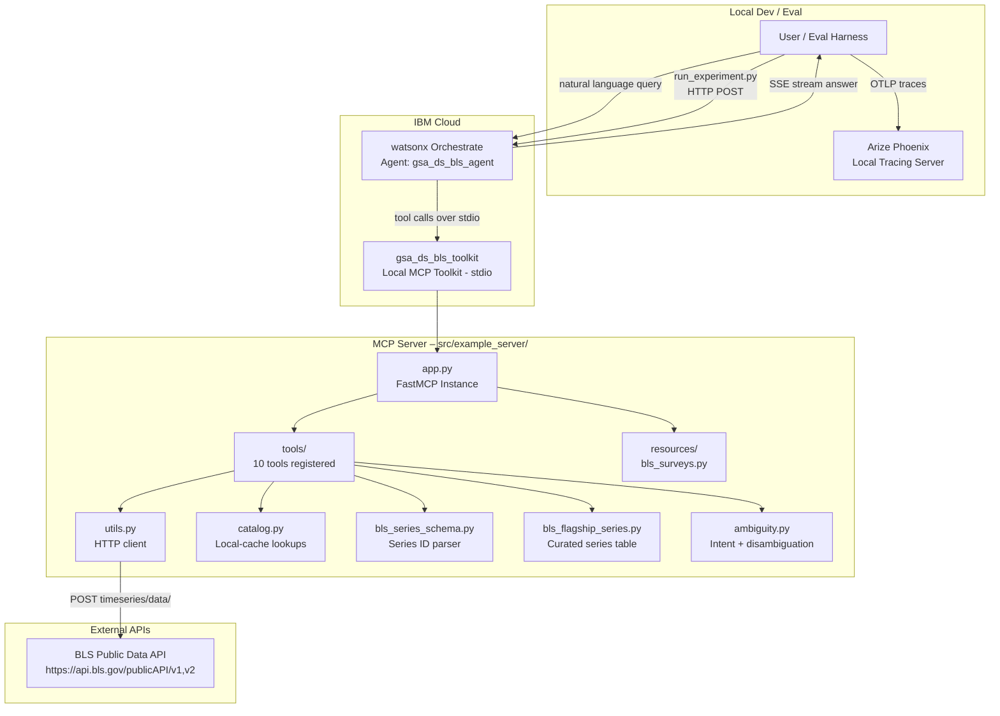

### 1.3 Repository Structure

```
gsa_mcp_hackathon/
├── main.py                        # Root entry point: imports app.py:main()
├── pyproject.toml                 # Package + all dependencies (uv)
├── requirements.txt               # Mirror of runtime deps (buildpack hosts)
├── Dockerfile                     # Container: streamable-HTTP on port 8080
├── manifest.yaml                  # cloud.gov (Cloud Foundry) deploy config
├── server.json                    # MCP registry metadata
├── .env.example                   # Template for all env vars (no secrets)
├── .gitignore                     # Excludes .env, _stage/, venv/, __pycache__
│
├── src/example_server/            # The MCP server package (never renamed from template)
│   ├── app.py                     # FastMCP instance + transport selection
│   ├── config.py                  # Settings, BLS URL constants, API version logic
│   ├── models.py                  # Pydantic models: BLSSeriesRequest, etc.
│   ├── utils.py                   # HTTP clients: fetch_json, fetch_bls, unwrap_bls_response
│   ├── routes.py                  # /health and /version HTTP routes
│   ├── catalog.py                 # Local-cache loader: code→name lookups
│   ├── ambiguity.py               # Intent parsing + disambiguation logic
│   ├── bls_flagship_series.py     # Curated flagship series table (12 surveys)
│   ├── bls_series_schema.py       # Series ID structural schemas + build/decode/validate
│   ├── bls_top_picks.py           # BLS top-picks list loader
│   ├── local-cache/               # ~150 BLS reference files (TSV/fixed-width)
│   │   ├── sm.area, sm.industry, ce.industry, la.area, ...
│   │   └── bls_top_picks          # Plain-text top-picks list
│   ├── tools/                     # One file per MCP tool
│   │   ├── __init__.py            # register_tools() aggregator
│   │   ├── answer_bls_question.py # Primary orchestrator tool
│   │   ├── suggest_series.py      # Flagship series discovery
│   │   ├── search_series.py       # Catalog keyword search
│   │   ├── build_series_id.py     # Construct ID from named parts
│   │   ├── decode_series_id.py    # Parse ID into human-readable fields
│   │   ├── validate_series_id.py  # Structural validity check (local only)
│   │   ├── get_series_metadata.py # Local metadata without network call
│   │   ├── get_series_data.py     # Live BLS API data retrieval (only tool with network I/O)
│   │   ├── lookup_area_code.py    # Find area codes by place name
│   │   └── lookup_industry_code.py# Find industry codes by name/NAICS
│   ├── prompts/
│   │   ├── __init__.py
│   │   └── bls_assistant.py       # MCP prompt for BLS assistant conversations
│   └── resources/
│       ├── __init__.py
│       └── bls_surveys.py         # bls://surveys/overview + bls://surveys/{code}
│
├── deploy/
│   ├── README.md                  # Deployment option chooser
│   ├── ibm/
│   │   ├── README.md
│   │   ├── agents/
│   │   │   ├── gsa_ds_bls_agent.yaml         # Primary agent spec (12 tools)
│   │   │   └── gsa_ds_bls_baseline_agent.yaml # No-tool baseline for eval comparison
│   │   ├── local-mcp-toolkit/     # ← USED IN PRODUCTION (the method that worked)
│   │   │   ├── server.py          # stdio entrypoint: imports app.py:mcp
│   │   │   ├── requirements.txt   # Pinned runtime deps
│   │   │   ├── toolkit.yaml       # Toolkit import template
│   │   │   ├── register-toolkit.sh# Idempotent register script
│   │   │   └── README.md
│   │   ├── code-engine-git-build/ # Build from Git → ICR → Code Engine
│   │   └── prebuilt-image/        # Deploy prebuilt public image to Code Engine
│   └── databricks/                # Databricks Apps kit (not used for this project)
│
├── eval/
│   ├── README.md
│   ├── phoenix/                   # ← The active evaluation harness
│   │   ├── agent.py               # OrchestrateAgent: chat completions endpoint
│   │   ├── agent_v2.py            # OrchestrateAgentV2: SSE streaming endpoint (current)
│   │   ├── create_dataset.py      # Upload CSV to Phoenix
│   │   ├── run_experiment.py      # Single experiment run (uses agent.py)
│   │   ├── run_multi_eval.py      # N-run aggregated eval (uses agent_v2.py)
│   │   ├── run_baseline.py        # No-tool baseline comparison
│   │   ├── datasets.yaml          # Dataset registry
│   │   ├── datasets/bls-eval-0/   # 30-question verified dataset
│   │   ├── judges/
│   │   │   ├── correctness_judge.py  # match_expected_response (LLM-as-judge)
│   │   │   └── relevance_judge.py    # check_answer_scope (LLM-as-judge)
│   │   ├── prompts/
│   │   │   ├── system_prompt_v1.txt  # Basic BLS analyst with tool conventions
│   │   │   └── system_prompt_v2.txt  # + explicit scope/refusal instructions
│   │   ├── final_eval_agent_v2.csv   # Final benchmark results (5 runs)
│   │   └── baseline_results.csv      # Baseline (no-tool) results for comparison
│   └── databricks/                # Databricks offline MLflow eval kit (not used here)
│
├── tests/                         # pytest test suite
├── docs/                          # Vendor reference materials (IBM, Databricks)
├── connections/                   # WxO connection spec files
├── knowledge-bases/               # WxO knowledge base specs (unused)
├── toolkits/                      # WxO toolkit spec files
├── tools/                         # WxO tool spec files
├── models/                        # WxO model spec files
│
└── *.md (plan files)              # Implementation plans (see Section 1.5)
```

### 1.4 Key Technology Choices

| Component | Choice | Reason |
|---|---|---|
| MCP framework | FastMCP 2.x–4.x | Template-provided; `ResourcesAsTools` transform available |
| Package manager | uv | Template-provided; fast, lockfile-based |
| HTTP client | httpx (async) | Async streaming, `trust_env=False`, redirect control |
| Config management | pydantic-settings | `SecretStr` masks API key in repr/logs |
| Transport (local) | stdio | Required by watsonx Orchestrate local MCP toolkit |
| Transport (HTTP) | streamable-http | Auto-selected when `PORT` env var injected |
| Evaluation tracing | Arize Phoenix | LLM-as-judge framework with OTLP trace collection |
| Judge model | LiteLLM + watsonx.ai | `meta-llama/llama-3-3-70b-instruct` via LiteLLM |
| Agent invocation | IBM Cloud IAM + REST | Direct HTTPX calls to Orchestrate API |

### 1.5 Implementation Plan Files

The root directory contains multiple `*.md` plan files. These were **design artifacts created during development** and represent completed or partially completed work. They remain useful as documentation of reasoning:

| File | Status | Content Summary |
|---|---|---|
| `bls-phase1-api-client-plan-aw.md` | ✅ Implemented | BLS API client design: config.py, utils.py, models.py |
| `bls-phase2-mcp-tools-plan-at.md` | ✅ Implemented | MCP tool design for the 10 primary tools |
| `bls-phase3-mcp-toolkit-plan.md` | ✅ Implemented | Toolkit registration and watsonx Orchestrate integration |
| `bls-mcp-integration-plan.md` | ✅ Implemented | Integration of all components; ResourcesAsTools transform |
| `bls-ambiguity-implementation-plan.md` | ✅ Implemented | Full ambiguity detection/clarification architecture |
| `bls-eval-harness-plan.md` | ✅ Implemented | Phoenix evaluation harness design |
| `bls-multi-run-eval-plan.md` | ✅ Implemented | Multi-run aggregation script design |
| `bls-series-enrichment-plan.md` | ✅ Implemented | Flagship series enrichment for get_series_data |
| `bls-series-6-coverage-plan.md` | ✅ Implemented | 6-survey expansion (LN, PR, MP, CW, WP, EI, CI) |
| `bls-top-picks-coverage-plan.md` | ✅ Implemented | BLS top-picks regression coverage |
| `bls-top-picks-coverage-plan.md` | ✅ Implemented | 29-series top-picks coverage guarantee |
| `ln-series-integration-plan.md` | ✅ Implemented | CPS/LN labor series integration |
| `gsa-ds-bls-agent-plan.md` | ✅ Implemented | Agent YAML and WxO deployment plan |

### 1.6 Submission and Presentation Materials

Three additional artefacts were created at the end of the project for the hackathon submission. They were added in the final two commits (`4498256`, `993c5f3`) and are not referenced by the server code, but they are essential context for understanding how the team framed the work and demonstrated results.

#### `submission_documentation/demo_script.md`

A fully scripted, timed (~4 minute) video walkthrough of the project. Added by commit `993c5f3`. The script orchestrates a live demonstration using the two deployed Orchestrate agents:

1. **`gsa_ds_bls_baseline_agent`** (no tools) is shown first to demonstrate the core problem: the model hedges, gives stale training data, or silently returns wrong values for recent BLS statistics.
2. **`gsa_ds_bls_agent`** (MCP-augmented) is shown second to demonstrate the solution: the agent calls `answer_bls_question`, the tool calls the BLS API, and the response includes exact published values with the series ID as provenance.

**Demo questions used:**
- "What was the U.S. national unemployment rate for each month of 2024?" → exercises `LNS14000000` via `answer_bls_question`
- "What is the current annual inflation rate based on the Consumer Price Index?" → exercises `CUUR0000SA0`, highlights ambiguity detection (rate vs. index)
- "What BLS data is available about job openings and hiring trends?" → exercises `suggest_series` for local discovery
- "Decode this BLS series ID for me: CES0000000001" → exercises `decode_series_id` for local decode

The script also includes backup/extended demo questions, a timing guide, and presenter tips. It is a faithful guide to what was actually demonstrated.

#### `docs/architecture.md` and `docs/architecture-summary.md`

Added by commit `4498256`. These are **generated architecture analysis documents** produced by independent inspection of the source code. They cover:

- `docs/architecture-summary.md` — a concise component table, key runtime dependency list, critical execution paths for `answer_bls_question` and `get_series_data`, design strengths (no-network default, `SecretStr` protection), and known tech debt items (unused `pandas` dep, underegistered example stubs)
- `docs/architecture.md` — a comprehensive architecture document with UML class diagrams, sequence diagrams, component diagrams, and dependency analysis (not to be confused with *this* handoff document, which captures development context rather than structural analysis)

These documents are consistent with the codebase as of the final commits. If the codebase changes significantly, they may drift from the actual implementation. The source of truth for architecture is always the code; these documents are reference material.

#### `submission_documentation/mcp_hackathon_bls_public_data.pptx` and `MCP-hackathon-sample-evaluation-document.docx`

Slide deck and evaluation document used for the hackathon submission. These are binary Office files and are not referenced by any code. The slide deck summarizes the project value proposition, architecture, and evaluation results for a non-technical audience. The evaluation document follows the hackathon's sample evaluation template.

---

## 2. MCP Server

### 2.1 Development History

The MCP server was developed in clearly defined phases, each building on the previous:

**Phase 1 (commits `9429e3a`, `007585d`):** BLS API client foundation
- Added `bls_api_key: SecretStr` to `config.py` via `pydantic-settings`
- Implemented `fetch_bls()` and `unwrap_bls_response()` in `utils.py`
- Defined `BLSSeriesRequest` Pydantic model with validators in `models.py`
- Added `validate_series_request()` for version-specific limit enforcement

**Phase 2 (commits `260bbb3`, `e026rb6`):** Core MCP tools
- Built 9 initial tools: `lookup_area_code`, `lookup_industry_code`, `build_series_id`, `decode_series_id`, `validate_series_id`, `search_series`, `suggest_series`, `get_series_metadata`, `get_series_data`
- Local-cache catalog loaded at import time from `~150` BLS TSV reference files
- Series schema parser covers SM, CE, LA, JT, CU surveys initially

**Phase 3 (commits `ee1fd54`, `68b513c`, `c9b4315`):** Survey expansion and tools integration
- Expanded to 12 surveys: added LN (CPS), PR (Productivity), MP (Multifactor), CW (CPI-W), WP (PPI), EI (International Price), CI (ECEC)
- Added `bls_flagship_series.py` with curated entries across all surveys
- Implemented `answer_bls_question` as the high-level orchestrator tool

**Phase 4 (commits `85dc6a9`, `14de4fd`):** Ambiguity detection
- Created `ambiguity.py` with intent parsing and disambiguation logic
- Implements `parse_intent_from_query` → `filter_candidates` → `detect_unresolved_dimensions` → `apply_safe_defaults` → `generate_clarification` pipeline
- 13 documented findings driving the design (see `bls-ambiguity-implementation-plan.md`)

**Phase 5 (commits `d01f25a`, `50f5049`, `1dbaec2`):** Top-picks coverage and enrichment
- Added `bls_top_picks.py` loader for all 29 BLS top-picks series
- Added regression test `tests/test_bls_top_picks_coverage.py` as acceptance criterion
- Series enrichment: `get_series_data` now returns `concept`, `measure_type`, `unit` for flagship series

### 2.2 Server Entry Point and Transport Selection

[`src/example_server/app.py`](src/example_server/app.py) is intentionally thin. It:

1. Creates the `FastMCP` instance named `"BLS Public Data Server"`
2. Calls four aggregator functions to wire up tools, prompts, resources, routes
3. Applies `ResourcesAsTools` transform so agents that only use tools can access BLS survey resources
4. Selects transport based on environment:

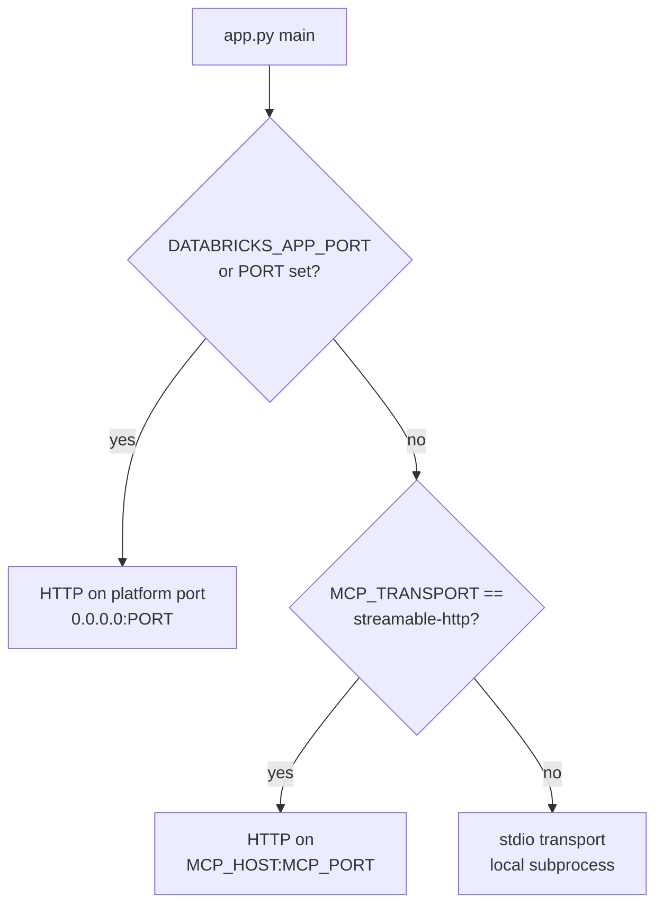

**Key decision — `ResourcesAsTools` transform:** watsonx Orchestrate's local MCP toolkit supports the full MCP protocol but in practice the LLM agent only invokes **tools**, not `resources/read`. Without this transform, the BLS survey reference content (survey overviews, series ID formats, catalog dimensions) would be inaccessible to the agent. The transform generates two synthetic tools: `list_resources` and `read_resource`, which the agent can call like any other tool.

### 2.3 Tool Architecture

All 10 BLS tools follow the **one-tool-per-file** pattern. Each file exposes a `register(mcp: FastMCP) -> None` function. [`tools/__init__.py`](src/example_server/tools/__init__.py) calls all `register()` functions via `register_tools(mcp)`.

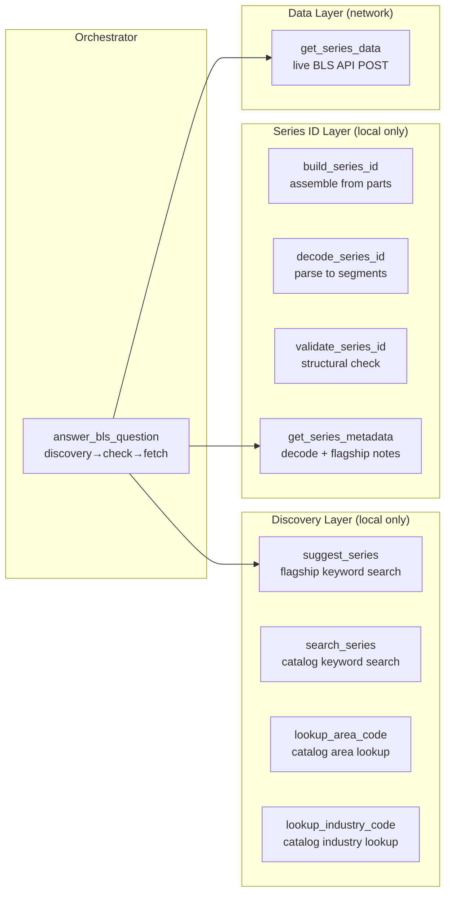

**Tool selection guide (from agent instructions):**
- `answer_bls_question` — primary tool for natural-language data questions; runs the full pipeline internally
- `suggest_series` — explore what series exist for a topic (uses flagship table)
- `search_series` — keyword/catalog search when survey code or geography is known
- `build_series_id` / `decode_series_id` / `validate_series_id` — series ID manipulation
- `lookup_area_code` / `lookup_industry_code` — code lookups before `build_series_id`
- `get_series_metadata` — decode + validate + notes without network call
- `get_series_data` — raw observations for known series IDs

### 2.4 BLS API Integration

**Only `get_series_data` (and by extension `answer_bls_question`) makes live network calls.** All other tools operate on locally-cached reference data.

The BLS API client is in [`src/example_server/utils.py`](src/example_server/utils.py):

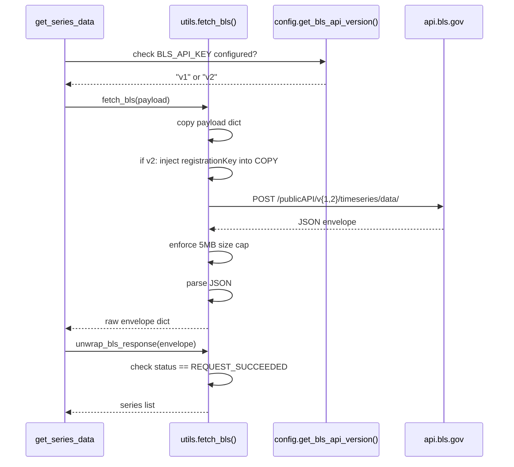

**API version selection:**
- When `BLS_API_KEY` env var is set and non-empty → v2 (500 req/day, 20-year range, 50 series/request)
- When absent → v1 (25 req/day, 10-year range, 25 series/request)
- Version is never hardcoded in tool code; always determined at call time by `get_bls_api_version()`

**BLS API limits enforced by `validate_series_request()`:**

| Limit | v1 | v2 |
|---|---|---|
| Series per request | 25 | 50 |
| Year range | 10 years | 20 years |
| Requests per day | 25 | 500 |
| `calculations` option | ❌ | ✅ |
| `annual_average` option | ❌ | ✅ |

**Response data integrity rules (enforced by `unwrap_bls_response()`):**
- `value` returned as the exact BLS string (`"274.310"`, never `274.31`)
- Missing observations (`"-"` or `"."`) passed through unchanged — never replaced with `0`
- `footnotes` list returned verbatim (codes `P`=preliminary, `R`=revised)
- No fields are fabricated when absent from the API response

### 2.5 Local Catalog System

[`src/example_server/catalog.py`](src/example_server/catalog.py) loads all BLS reference files from `src/example_server/local-cache/` **once at import time** into a singleton `catalog` object. This provides fast code→name lookups without network calls.

The local-cache directory contains ~150 files downloaded from `https://download.bls.gov/pub/time.series/` for 12 surveys. The registry in `catalog.py` maps `(survey, dimension)` tuples to file paths, column layouts (TSV key/value columns or fixed-width), and optional padding rules.

**Coverage:** SM, CE, LA, JT, CU, LN, PR, MP, CW, WP, EI, CI surveys; area codes, industry codes, item codes, data types, seasonal flags, and more.

### 2.6 Series ID Schema System

[`src/example_server/bls_series_schema.py`](src/example_server/bls_series_schema.py) defines the structural layout of every BLS series ID as a `SeriesSchema` with ordered `SeriesSegment` entries. This powers `decode_id()`, `build_id()`, and `get_schema()`.

Each segment specifies: name, start position (after the 2-char prefix), length, description, and an optional `catalog_key` for code→name resolution.

**Variable-length series:** Some surveys (CW, WP, EI) have variable-length series IDs. The schema handles this with `total_length=None` and `alt_segments` for alternate body layouts.

### 2.7 Ambiguity Detection System

[`src/example_server/ambiguity.py`](src/example_server/ambiguity.py) is the most complex module. It was designed to prevent the agent from silently fetching the wrong series when a question is ambiguous.

**Pipeline:**
1. `parse_intent_from_query(query)` → structured intent (measure type, seasonal preference, geographic level, concept)
2. `filter_candidates(candidates, intent)` → eligible series only
3. `detect_unresolved_dimensions(candidates, intent)` → list of blocking ambiguities
4. If unresolved: `generate_clarification(candidates, intent)` → clarification question
5. If only SA ambiguous: `apply_safe_defaults(candidates, intent)` → apply per-survey default

**Safe defaults for seasonal adjustment** (defined in both `ambiguity.py` and `config.py`):

| Survey | Default | Reason |
|---|---|---|
| CE | S (seasonally adjusted) | Headline payrolls series is SA |
| LA | S | National/state headline unemployment is SA |
| LN | S | CPS headline series are SA |
| JT | S | JOLTS headline is SA |
| CU | U (not seasonally adjusted) | CPI-U NSA is the reference series (CUUR0000SA0) |
| CW | U | CPI-W NSA is the COLA reference |
| SM | U | State/metro data is predominantly NSA |

**Key design decision:** The ambiguity module blocks API calls when candidates span different `measure_type` values (e.g., rate vs. level). It only applies safe defaults for seasonal adjustment conflicts, not measure type conflicts. This prevents the common failure of fetching an index when the user asked for a rate.

### 2.8 Every Source File — What It Does and Why It Exists

This section gives a terse but complete description of every file in `src/example_server/`. Reading code in isolation does not tell you *why* a file was created or what problem it solves; that context is here.

#### Top-level package files

| File | Role | Key symbols |
|---|---|---|
| [`__init__.py`](src/example_server/__init__.py) | Exports `__version__` string; keeps the package importable | `__version__` |
| [`app.py`](src/example_server/app.py) | **Server entry point.** Creates the `FastMCP` instance, wires up all submodules by calling their aggregators, applies the `ResourcesAsTools` transform, and selects stdio vs HTTP transport. Intentionally thin — no logic lives here. | `mcp`, `main()` |
| [`config.py`](src/example_server/config.py) | **All configuration in one place.** `Settings` reads from env/`.env` via `pydantic-settings`. Holds `bls_api_key` as `SecretStr` (never logged), transport settings, BLS URL constants, per-version API limits, and seasonal-adjustment defaults. `get_bls_api_version()` is the single point of truth for v1/v2 selection. | `settings`, `get_bls_api_version()`, `BLS_V1_BASE_URL`, `SEASONAL_DEFAULTS` |
| [`models.py`](src/example_server/models.py) | **Pydantic input models.** `BLSSeriesRequest` validates all BLS API request parameters (series IDs, year range, v2-only flags) with cross-field validators. `QueryIntent` and `CandidateSeries` are dataclasses used by the ambiguity pipeline. `ResponseFormat` and `PaginationParams` are from the original template and kept for backward compatibility. | `BLSSeriesRequest`, `QueryIntent`, `CandidateSeries` |
| [`utils.py`](src/example_server/utils.py) | **All HTTP I/O and response handling.** Two clients: `fetch_json` (generic GET for the example API origin) and `fetch_bls` (BLS POST with key injection). `unwrap_bls_response` validates the BLS envelope and enforces data integrity rules. `validate_series_request` enforces v1/v2 rate limits. `paginate` is a utility for list tools. | `fetch_bls()`, `unwrap_bls_response()`, `BLSAPIError`, `validate_series_request()` |
| [`routes.py`](src/example_server/routes.py) | **HTTP-only infrastructure.** Registers `/health` and `/version` endpoints on the FastMCP app via `@mcp.custom_route`. Only active when the server runs over HTTP (Code Engine, Databricks). Health check is dependency-free and fast so cloud platforms detect startup correctly. | `register_routes()` |
| [`catalog.py`](src/example_server/catalog.py) | **Local-cache catalog loader.** Reads all BLS reference TSV and fixed-width files from `local-cache/` **once at import time** into a `Catalog` singleton. Provides `catalog.get(survey, dim)` → code→name dict and `catalog.search(survey, dim, query)` → ranked substring matches. Used by `decode_series_id`, `lookup_area_code`, `lookup_industry_code`, `search_series`, and `build_series_id`. See Section 2.9 for the full file inventory. | `catalog` (singleton), `Catalog.get()`, `Catalog.search()` |
| [`bls_series_schema.py`](src/example_server/bls_series_schema.py) | **Series ID structural schemas.** Defines `SeriesSchema` and `SeriesSegment` for every supported survey prefix (SM, CE, LA, JT, CU, LN, PR, MP, CW, WP, EI, CI, PC). Provides `decode_id()`, `build_id()`, `get_schema()`. Each segment maps to a position in the series ID and optionally to a `catalog_key` for name resolution. | `SCHEMAS`, `decode_id()`, `build_id()`, `get_schema()` |
| [`bls_flagship_series.py`](src/example_server/bls_flagship_series.py) | **Curated series table.** ~60+ hand-curated `FlagshipEntry` objects covering the most important series for all 12 surveys. Each entry has `series_id`, `keywords` for search, `concept`, `measure_type`, and `unit`. Powers `suggest_series` (keyword search) and enriches `get_series_data` / `get_series_metadata` responses. See Section 2.10 for rationale and limitations. | `FLAGSHIP_SERIES`, `get_flagship()`, `search_flagship()` |
| [`bls_top_picks.py`](src/example_server/bls_top_picks.py) | **BLS top-picks loader.** Parses `local-cache/bls_top_picks` (29 series from https://www.bls.gov/data/top-picks.htm) into `TopPickEntry` dataclasses at import time. Used by `tests/test_bls_top_picks_coverage.py` as the acceptance criterion — every top-pick must resolve via `get_flagship()`. Not called by any MCP tool directly; it validates coverage. | `TOP_PICKS`, `get_top_pick()` |
| [`ambiguity.py`](src/example_server/ambiguity.py) | **Intent parsing and disambiguation.** The largest module (~650 lines). `parse_intent_from_query` extracts structured intent from free-text; signal dictionaries (`_RATE_SIGNALS`, `_LEVEL_SIGNALS`, etc.) detect measure type. `filter_candidates` applies eligibility rules. `detect_unresolved_dimensions` identifies blocking ambiguities. `generate_clarification` produces user-facing questions. `apply_safe_defaults` resolves seasonal-adjustment conflicts using `SAFE_DEFAULTS`. | `parse_intent_from_query()`, `filter_candidates()`, `detect_unresolved_dimensions()`, `generate_clarification()`, `apply_safe_defaults()` |

#### `tools/` — one file per MCP tool

| File | Tool name registered | What it does |
|---|---|---|
| [`__init__.py`](src/example_server/tools/__init__.py) | — | `register_tools(mcp)` aggregator; calls all tool `register()` functions in dependency order |
| [`answer_bls_question.py`](src/example_server/tools/answer_bls_question.py) | `answer_bls_question` | **Primary orchestrator.** Runs the full intent→ambiguity→validate→fetch pipeline. The only tool that calls `fetch_bls`. Returns structured response with observations, summary sentence, and provenance. If ambiguous, returns a clarification question instead of fetching. |
| [`suggest_series.py`](src/example_server/tools/suggest_series.py) | `suggest_series` | Keyword-searches `bls_flagship_series.py` and returns ranked suggestions with rationale. Entirely local — no network. Good for discovery when the user doesn't know which survey to use. |
| [`search_series.py`](src/example_server/tools/search_series.py) | `search_series` | Full-text search over all local-cache catalog files. Covers all 12 surveys; uses signal dictionaries to auto-detect the survey from the query when not specified. Returns series IDs with decoded labels. Entirely local. |
| [`build_series_id.py`](src/example_server/tools/build_series_id.py) | `build_series_id` | Assembles a valid BLS series ID from named dimension values (survey, state, area, industry, etc.) by calling `bls_series_schema.build_id()`. Validates and decodes the result. Entirely local. |
| [`decode_series_id.py`](src/example_server/tools/decode_series_id.py) | `decode_series_id` | Calls `bls_series_schema.decode_id()` to parse a series ID into named, human-readable segments with catalog lookups. Returns `null` label for unknown codes rather than fabricating a description. Entirely local. |
| [`validate_series_id.py`](src/example_server/tools/validate_series_id.py) | `validate_series_id` | Structural validation: checks prefix, length, and all segment codes against the local catalog. Returns `valid` bool and `issues` list. Does NOT make a network call — the BLS API is the authoritative validator for edge cases. |
| [`get_series_metadata.py`](src/example_server/tools/get_series_metadata.py) | `get_series_metadata` | Combines decode + validate + flagship notes in one call. Returns `concept`, `measure_type`, `unit`, and `notes` for flagship series. Explicitly designed for the agent to call before fetching to understand what it's about to retrieve. Entirely local. |
| [`get_series_data.py`](src/example_server/tools/get_series_data.py) | `get_series_data` | **The only tool making live BLS API calls.** Validates the request via `BLSSeriesRequest`, enforces v1/v2 limits, POSTs to BLS, enriches results with flagship metadata. Values returned as strings to preserve published precision. |
| [`lookup_area_code.py`](src/example_server/tools/lookup_area_code.py) | `lookup_area_code` | Searches area code catalogs for the queried place name. Survey-aware: SM uses `sm.area`, LA uses `la.area`, JT uses `jt.area`, CU uses `cu.area`. Returns ranked matches. Entirely local. |
| [`lookup_industry_code.py`](src/example_server/tools/lookup_industry_code.py) | `lookup_industry_code` | Searches industry code catalogs for the queried name or NAICS code. Survey-aware: SM uses `sm.industry`, CE uses `ce.industry`, JT uses `jt.industry`. Returns ranked matches. Entirely local. |
| [`example_tool.py`](src/example_server/tools/example_tool.py) | `example_search_datasets` | **Template stub — still registered.** Returns mock placeholder data. Does not call BLS. Should be deregistered (remove from `tools/__init__.py`) but is harmless. Causes the toolkit to show 13 tools instead of 12 in the agent spec. |

#### `prompts/` — MCP prompt templates

| File | Prompt name | What it does |
|---|---|---|
| [`__init__.py`](src/example_server/prompts/__init__.py) | — | `register_prompts(mcp)` aggregator |
| [`bls_assistant.py`](src/example_server/prompts/bls_assistant.py) | `bls_assistant` | Detailed system prompt for MCP clients that support prompts (e.g. Claude Desktop). Covers tool workflow, ambiguity handling, measure-type distinctions, seasonal-adjustment rules, the "never fabricate series IDs" rule, data freshness, and all 12 surveys. MCP-aware clients can offer this as a conversation starter. |
| [`example.py`](src/example_server/prompts/example.py) | `example_prompt` | **Template stub.** Returns a placeholder prompt. Can be removed from registration. |

#### `resources/` — MCP resources exposed as tools

| File | Resource URIs | What it does |
|---|---|---|
| [`__init__.py`](src/example_server/resources/__init__.py) | — | `register_resources(mcp)` aggregator |
| [`bls_surveys.py`](src/example_server/resources/bls_surveys.py) | `bls://surveys/overview`, `bls://surveys/{survey_code}` | Generates structured reference pages for all 12 BLS surveys from `bls_series_schema.py`, `catalog.py`, and `bls_flagship_series.py`. The overview lists every survey with format and tool guidance. The parameterized resource gives segment-by-segment detail for one survey. Because of the `ResourcesAsTools` transform in `app.py`, these are also callable as `list_resources` / `read_resource` tools. |
| [`example.py`](src/example_server/resources/example.py) | `example://info/server`, `example://docs/{topic}` | **Template stubs.** Return placeholder text. Can be removed from registration. |

### 2.9 Local-Cache Files — Rationale, Contents, and Limitations

**Why we uploaded these files:** The BLS Public Data API does not provide a programmatic catalog query endpoint. To resolve a code like `"17"` in an SM series ID to `"Illinois"`, or to let the agent search for `"Chicago"` and get back `"16980"`, we need a local reference table. BLS publishes these tables as plain-text TSV and fixed-width files at `https://download.bls.gov/pub/time.series/<survey>/`. We downloaded them and committed them to the repo so the server has zero external dependencies for discovery and decoding operations — only `get_series_data` ever makes a live network call.

**Why only specific surveys and dimensions:** We included only the surveys and dimensions actively used by the 12 registered tools. Files for surveys we don't decode (e.g., OE — Occupational Employment) were not included. The catalog registry in `catalog.py` is the authoritative list of what is loaded; files in `local-cache/` that are not in the registry are present on disk but not loaded.

**Agent capability limitations from this choice:** The agent can only build, decode, validate, and search series IDs for the surveys whose catalog files are included. If a user asks about a BLS survey not in the catalog (e.g., IP — Industry Productivity, or OE — Occupational Employment Statistics), the tools will return an "unrecognised survey prefix" error. This is a known, deliberate limitation — expanding coverage requires adding catalog files and registering them in `catalog.py`.

**File inventory by survey:**

| Survey prefix | Files in local-cache/ | What they contain |
|---|---|---|
| **SM** (State and Metro Employment) | `sm.area`, `sm.state`, `sm.supersector`, `sm.data_type`, `sm.industry` | Metro area codes, state codes, supersector codes (e.g. "05"=Total Private), data type codes (e.g. "01"=All Employees), and 6-digit industry codes |
| **CE** (Current Employment Statistics) | `ce.industry`, `ce.datatype`, `ce.seasonal`, `ce.supersector`, `ce.period`, `ce.series`, `ce.txt` | National industry and supersector codes, data types, seasonality codes, and the full CE series catalog |
| **LA** (Local Area Unemployment Statistics) | `la.area`, `la.area_type`, `la.measure` | 15-char area codes for all states, counties, MSAs, and the national aggregate; area type codes; measure codes (e.g. "03"=unemployment rate) |
| **JT** (Job Openings and Labor Turnover — JOLTS) | `jt.area`, `jt.state`, `jt.industry`, `jt.dataelement`, `jt.sizeclass`, `jt.ratelevel` | JOLTS-specific industry and area codes; data element codes (JO=Job Openings, HI=Hires, QU=Quits, LD=Layoffs/Discharges, TS=Total Separations); size classes and rate/level flags |
| **CU** (Consumer Price Index — All Urban) | `cu.area`, `cu.item`, `cu.aspect`, `cu.base`, `cu.period`, `cu.periodicity`, `cu.seasonal`, `cu.series`, `cu.txt` | CPI area codes (U.S.=0000, urban regions), item codes (SA0=All Items, SAF=Food, SAE=Energy, etc.); the full CU series catalog |
| **CW** (CPI-W — Urban Wage Earners) | `cw.area`, `cw.item`, `cw.aspect`, `cw.base`, `cw.period`, `cw.periodicity`, `cw.seasonal`, `cw.series`, `cw.txt` | Same structure as CU; the CW series uses the CPI-W urban wage earner/clerical worker population |
| **LN** (Labor Force Statistics / CPS) | `ln.seasonal`, `ln.lfst`, `ln.sexs`, `ln.ages`, `ln.periodicity`, `ln.series`, plus 30+ dimension files | LN is the most complex survey — the series ID is largely opaque (10-char encoded code). Dimension files cover labor force status, sex, age, race, marital status, educational attainment, occupation, industry, disability, veteran status, and many more. The `ln.series` file maps series IDs to titles. |
| **PR** (Productivity and Costs) | `pr.sector`, `pr.class`, `pr.measure`, `pr.duration`, `pr.seasonal`, `pr.series`, `pr.txt` | Sector codes (nonfarm business, manufacturing), class codes (output per hour, unit labor costs), measure and duration codes |
| **MP** (Multifactor Productivity) | `mp.sector`, `mp.measure`, `mp.duration`, `mp.seasonal`, `mp.series`, `mp.txt` | Similar to PR; covers total factor productivity by sector |
| **WP** (PPI Commodity Data) | `wp.group`, `wp.item`, `wp.period`, `wp.seasonal`, `wp.series`, `wp.txt` | PPI commodity group and item codes; note the `wp.item` file uses col1=code, col2=name (non-default column layout) |
| **EI** (International Price Program) | `ei.index`, `ei.period`, `ei.seasonal`, `ei.series`, `ei.txt` | Import/export price index codes |
| **CI** (Employer Costs for Employee Compensation / ECEC) | `ci.owner`, `ci.industry`, `ci.occupation`, `ci.subcell`, `ci.estimate`, `ci.periodicity`, `ci.seasonal`, `ci.series`, `ci.area`, `ci.aspect`, `ci.txt` | Ownership codes, industry/occupation codes, estimate type codes (total compensation, wages, benefits) |
| **QCEW** (Quarterly Census of Employment and Wages) | `qcew-area-titles-txt.txt`, `qcew-datatype-titles-txt.txt`, `qcew-industry-titles.txt`, `qcew-ownership-titles-txt.txt`, `qcew-size-titles-text.txt` | Fixed-width format (5-char code + description). Covers area, industry, data type, ownership, and size codes. Used for catalog lookups but QCEW is not a currently supported series ID prefix. |
| **BD** (Business Dynamics Statistics) | `bd.industry`, `bd.state`, `bd.dataclass`, `bd.dataelement`, `bd.ratelevel`, `bd.seasonal` | BD-specific industry and state codes, data elements, and rate/level flags. Loaded but BD is not a supported series ID prefix in `bls_series_schema.py`. |
| **AP** (Average Energy Prices) | `ap.area`, `ap.item` | Area and item codes for average energy price data. Loaded but AP is not currently a supported series prefix. |
| **NB** (National Compensation Survey) | `nb.datatype`, `nb.estimate`, `nb.industry`, `nb.occupation`, `nb.ownership`, `nb.provision`, `nb.subcell` | NB-specific dimension codes. Loaded but NB is not a supported series prefix. |
| **PC** (Producer Price Index — Industry) | `pc.industry`, `pc.product` | PC industry and product codes; `pc.product` uses col1=code, col2=name. Loaded but PC is not fully supported as a series prefix. |
| **SU** (Average Weekly Hours) | `su.area`, `su.item` | Loaded but SU is not a supported series prefix. |
| **CX** (Consumer Expenditure Survey) | `cx.characteristics`, `cx.demographics`, `cx.item`, `cx.process` | Loaded but CX is not a supported series prefix. |
| **bls_top_picks** | (single file, not TSV) | 29 series from https://www.bls.gov/data/top-picks.htm in the format `Title - SERIES_ID`. Parsed by `bls_top_picks.py`. Not a catalog lookup table — used only by the coverage regression test. |

**Files present on disk but NOT in the catalog registry:** Several files exist in `local-cache/` (e.g., `ce.series`, `cu.series`, `ln.series`, `mp.series`, `pr.series`, `wp.series`, etc.) that are present but only some are registered. The `ln.series` file is registered and maps LN series IDs to their titles — this is how `decode_series_id` resolves LN series names. The `.txt` and `.series` files for other surveys are reference files that were downloaded but not yet integrated.

**How to refresh local-cache files:**
```bash
# Download from BLS (replace <survey> with the prefix, lowercase):
curl https://download.bls.gov/pub/time.series/<survey>/<survey>.<dimension> \
  -o src/example_server/local-cache/<survey>.<dimension>

# Then run tests to confirm no regressions:
uv run pytest tests/ -v
```

### 2.10 Flagship Series Table — Rationale and Limitations

**Why we built a curated table instead of searching the BLS catalog:** The BLS catalog files contain tens of thousands of series IDs. Presenting all of them to the agent would be unhelpful — the agent would not know which series are authoritative, frequently cited, or semantically meaningful. The flagship table provides:
- A vetted, manageable set (~60+ entries) of the most important series
- Rich metadata (`concept`, `measure_type`, `unit`, `notes`) that the BLS catalog does not provide
- Keyword lists that the ambiguity/discovery engine can search
- Pre-verified series IDs — each was confirmed to return data from the BLS API

**What the agent can and cannot do because of this design:**

| Can do | Cannot do |
|---|---|
| Quickly find the canonical series for unemployment, payrolls, CPI, job openings, wages, productivity | Find series IDs for obscure industries, sub-state geographies not in the flagship table, or less-common measures |
| Enrich `get_series_data` responses with concept/unit metadata for flagship series | Provide concept/unit metadata for non-flagship series (returns raw decoded labels only) |
| Use `suggest_series` to find the best series for 12 economic concepts across 12 surveys | Cover the full BLS catalog of ~200,000+ series |
| Search by keyword (e.g. "Houston payrolls" → `SMU48264200000000001`) | Search by NAICS code, geographic FIPS code, or other machine codes — `search_series` handles these instead |

**Extending the flagship table:** To add a new series, append a `FlagshipEntry` to the appropriate `_XX_ENTRIES` list in [`bls_flagship_series.py`](src/example_server/bls_flagship_series.py). Verify the series ID returns data from the BLS API before committing, then add keywords that reflect how users are likely to ask about it. The coverage regression test (`tests/test_bls_top_picks_coverage.py`) must continue to pass.

### 2.11 Agent Hallucination Prevention — Series ID Fabrication, LN Metadata Convention, Schema Length Fix

This section documents three closely-related bugs and their fixes. All three arose from the same root cause: the LLM agent fabricating or incorrectly handling BLS series IDs because the server did not give it enough explicit instruction or the schema was structurally wrong.

**Why this is one of the most important things we fixed:** Series ID fabrication was silent and undetectable by the user. The agent would produce a plausible-looking series ID (correct length, correct prefix, coherent segment values), but it would not actually exist in the BLS API — or worse, it would exist but refer to a different series entirely. The eval harness made this problem visible, but only because the judge could compare against known expected answers.

#### Fix 1 — "Never Fabricate a Series ID" Prompt Rule (commit `1fdbc59`)

**What happened:** The agent was occasionally generating BLS series IDs from memory — drawing on training data about BLS series formats — instead of calling tools to discover them. LN (CPS) series IDs are particularly prone to this because they look like a fixed-width opaque code (e.g., `LNS14000000`). The agent would recall the most common series correctly but fabricate plausible-sounding IDs for less common measures.

**What was fixed:** A "Series ID Ground Rule — Never Fabricate" block was added to [`src/example_server/prompts/bls_assistant.py`](src/example_server/prompts/bls_assistant.py) (the MCP prompt used by Claude Desktop and similar MCP-aware clients):

```
## Series ID Ground Rule — Never Fabricate

**You must never invent, guess, or recall a BLS series ID from memory.**

Every series ID you use must come directly from one of these sources in the
current conversation:
- A tool response (suggest_series, search_series, answer_bls_question,
  build_series_id, get_series_metadata)
- The user, who supplied it explicitly

If none of those sources return a series ID for the user's request, say so clearly:
"I wasn't able to locate a specific series ID for that topic using the
available tools. This data may exist in BLS but it isn't in the server's
current catalog. You can browse https://data.bls.gov/timeseries/ to find
the series ID and then ask me to fetch it."

**Do not** state or use a series ID that a tool did not return in this
conversation — even when you are highly confident. LN (CPS) series IDs are
opaque codes that cannot be derived from BLS documentation; they must come
from a tool result.
```

**Why this rule is especially critical for LN series:** LN (CPS) series IDs like `LNS14000000` are opaque 10-character codes that do not encode dimension values in a human-readable way (unlike CE series IDs, where industry codes appear directly in the ID string). There is no way to derive a valid LN series ID from first principles without consulting the catalog. A model that attempts to do so will silently produce wrong results.

**Scope:** This rule was added to `bls_assistant.py` (the MCP prompt). The eval harness agent uses a separate prompt in `eval/phoenix/prompts/system_prompt_v2.txt`. The same no-fabrication principle was enforced there implicitly via the CRITICAL CONVENTIONS — see Fix 2 below.

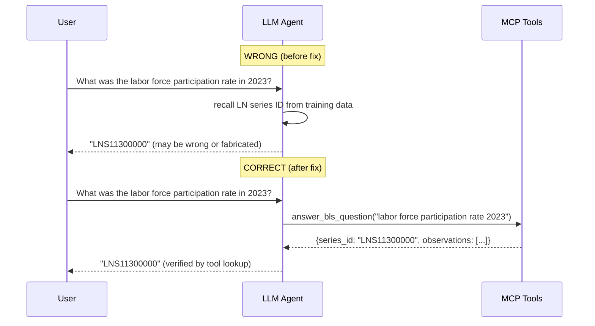

#### Fix 2 — CRITICAL CONVENTION #2: Call `get_series_metadata` for LN Properties (commit `cbfb335`)

**What happened:** When asked about the properties of an LN series (measure type, unit, concept, seasonal adjustment status), the agent was attempting to infer those properties by pattern-matching on the series ID string — analogous to guessing what a file contains from its filename. For LN series, this is structurally impossible because the 10-character body is an opaque encoded integer, not a human-readable concatenation of dimension values. The agent was returning the wrong `measure_type` for LN series (e.g., treating a rate as a level or vice versa) even when calling `get_series_metadata`.

**What was fixed:** `eval/phoenix/prompts/system_prompt_v2.txt` was updated (the prompt injected by the eval harness) to add CRITICAL CONVENTION #2 and renumber subsequent conventions:

```
2. When asked about a series' properties — measure type, unit, concept,
   seasonal adjustment status, or description — call get_series_metadata
   first. Do NOT infer these attributes by manually decoding the series ID
   body, as LN and other surveys use opaque identifiers whose digits do not
   directly encode measure type.
```

**Why this matters for the eval:** Several eval questions ask "What is the measure type / unit of series X?" — particularly for LN series. Without this convention, the agent would decode the series ID structurally, see opaque codes, and either refuse to answer or guess incorrectly. With this convention, the agent calls `get_series_metadata` which looks up the flagship table and returns the pre-verified `measure_type` and `unit` for known series.

**Relationship to Fix 1:** Fix 1 prevents fabricating series IDs; Fix 2 prevents fabricating *metadata about* series IDs. Together they enforce a strict no-inference rule: neither the series ID itself nor its interpretation should come from the agent's training data.

#### Fix 3 — Series ID Length Cap Incorrect for LN (commit `93ace1a`)

**What happened:** The series ID validator in [`src/example_server/bls_series_schema.py`](src/example_server/bls_series_schema.py) was enforcing an 18-character maximum length cap for all series IDs. This was derived from the most common BLS survey format (SM, CE, LA, JT, CU all have 18-char IDs). However, LN (CPS) series IDs are **20 characters** long, and JT has an extended 21-character variant. The 18-char cap caused `validate_series_id` to report valid LN series IDs as invalid, and caused build/decode failures for extended JT IDs.

**What was fixed:** The `SeriesSchema` dataclass was updated with an `alt_segments` field that allows per-survey variable-length definitions. The `total_length` field was set to `None` for variable-length surveys (CW, WP, EI, JT), and LN was given the correct 20-character total length. The `decode_id()`, `build_id()`, and `validate_series_id()` functions were updated to skip the length guard for `total_length=None` schemas.

**Impact:** The fix allowed the server to correctly handle the full LN series catalog, which contains ~200+ valid series IDs with 20-char IDs. Without this fix, any attempt to validate, decode, or build an LN series ID would fail structurally, making the entire LN survey effectively inaccessible through the tool chain.

**Structural note:** The `bls_series_schema.py` module also added support for the PC (Producer Price Index — Industry Data) survey prefix in the same commit, expanding coverage from 12 to 13 schema-registered surveys.

#### Summary Table — Hallucination Prevention Fixes

| Issue | Commit | File(s) changed | Type of fix |
|---|---|---|---|
| Agent fabricates LN series IDs from memory | `1fdbc59` | `src/example_server/prompts/bls_assistant.py` | Prompt rule (never fabricate) |
| Agent infers LN measure type from opaque ID body | `cbfb335` | `eval/phoenix/prompts/system_prompt_v2.txt` | Prompt rule (call metadata first) |
| LN series IDs incorrectly fail length validation | `93ace1a` | `src/example_server/bls_series_schema.py`, `catalog.py`, `models.py`, `resources/bls_surveys.py`, tests | Schema structural fix |

**Verification:** The LN series length fix is covered by `tests/test_bls_series_schema.py` and `tests/test_bls_utils.py` (both extended in `93ace1a`). The prompt-based fixes are validated by the eval harness results — the correctness score improved on LN-related questions after these changes were deployed.

---

## 3. Security and Authentication

### 3.1 Security Architecture Overview

The project has **two separate credential systems** with different security boundaries:

```mermaid
graph TD
    subgraph "Credential 1: BLS API Key"
        BLS_ENV[BLS_API_KEY\nenv var / .env]
        BLS_CONFIG[config.py\nSecretStr field]
        BLS_UTILS[utils.fetch_bls\npayload copy + inject]
        BLS_API[BLS Public Data API\nregistrationKey in POST body]
        BLS_ENV --> BLS_CONFIG
        BLS_CONFIG --> BLS_UTILS
        BLS_UTILS --> BLS_API
    end

    subgraph "Credential 2: IBM Cloud API Key"
        IBM_ENV[IBM_CLOUD_API_KEY\nenv var / .env]
        AGENT_PY[agent_v2.py\n_get_iam_token]
        IAM[iam.cloud.ibm.com\ntoken exchange]
        BEARER[Bearer Token\ncached in memory]
        WXO_API[Orchestrate API\nAuthorization: Bearer]
        IBM_ENV --> AGENT_PY
        AGENT_PY --> IAM
        IAM --> BEARER
        BEARER --> WXO_API
    end

    subgraph "Credential 3: WxO API Key (deployment only)"
        WXO_KEY[WXO_API_KEY\nshell variable only]
        REGISTER[register-toolkit.sh\norchestrate env activate]
        WXO_KEY --> REGISTER
    end
```

### 3.2 BLS API Key — Storage, Retrieval, and Use

**Storage:**
- In `.env` (git-ignored via `.gitignore`) as `BLS_API_KEY=<value>`
- In watsonx Orchestrate as a `key_value` connection named `bls_api_connection` (Orchestrate's secret store)
- **Never in source code, never in plan files, never in git history**

**Retrieval in the MCP server:**
```python
# config.py
class Settings(BaseSettings):
    bls_api_key: SecretStr = SecretStr("")
```
`pydantic.SecretStr` ensures the value is masked (`**********`) in all `repr()`, `str()`, log outputs, and error messages. The raw value is only accessible via `.get_secret_value()`.

**Use in `utils.fetch_bls()`:**
```python
request_payload = dict(payload)   # copy caller's dict — never mutate
if version == "v2":
    request_payload["registrationKey"] = settings.bls_api_key.get_secret_value()
# key is in the HTTP request body, never in URL, headers, or logs
```

**Protection from exposure:**
- `unwrap_bls_response()` calls `_contains_api_key(str(m))` — a regex matching 32-char hex strings — to filter any BLS error messages that might echo back the key
- Error messages in `fetch_bls()` never include response bodies, headers, or the key value
- HTTP 401/403 on v2 produces: `"BLS API rejected the registration key. Verify BLS_API_KEY is a valid registered key."` — no key value

**In watsonx Orchestrate:** The `register-toolkit.sh` script creates a `key_value` connection. When Orchestrate starts the stdio process, it injects `BLS_API_KEY` as an environment variable into the subprocess. The key never touches disk during this process.

#### Complete BLS API Key Credential Flow

The diagram below traces the full path of the BLS API key from the moment a human operator provides it to the moment it reaches the BLS API endpoint — and identifies every protection boundary along the way.

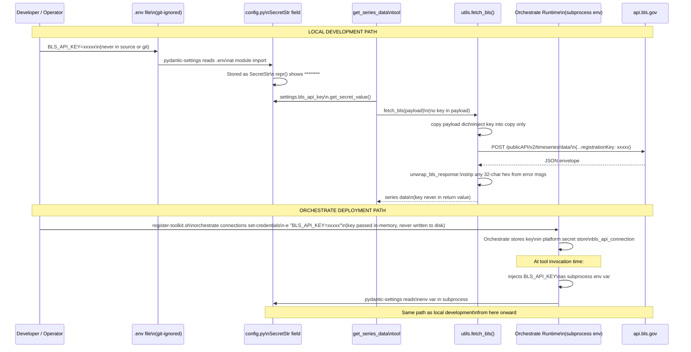

**Key protection points:**
1. `.env` is git-ignored — the key never enters version control
2. `SecretStr` masks the value in all Python string representations, log output, and `__repr__`
3. `fetch_bls()` copies the caller's payload dict before injecting the key — the key is never stored on the tool's input object
4. The key travels in the POST body (JSON), never in the URL or as an HTTP header — it does not appear in access logs that log only URLs
5. `_contains_api_key()` in `unwrap_bls_response()` scans BLS error messages for 32-char hex patterns and strips them before the message is returned to the agent or logged
6. In Orchestrate, the key is stored in Orchestrate's secret store and injected at subprocess start — it is never written to `toolkit.yaml`, `server.py`, or any file uploaded with the package

#### Why `.env` Files Are Not Uploaded with the Toolkit

This is a critical point that tripped up the team early. The `register-toolkit.sh` script uploads a **staged package directory** (`_stage/`) to Orchestrate, not the entire repo. That staging directory contains only:
- `example_server/` (the Python package)
- `server.py` (the stdio entrypoint)
- `requirements.txt` (runtime dependencies)

**The `.env` file is explicitly excluded** — it is never staged. If the `.env` file were uploaded, the BLS API key would be stored in Orchestrate's filesystem in plaintext, accessible to anyone with access to the toolkit. Instead, the key is stored in Orchestrate's secret store via the `bls_api_connection` mechanism and injected at runtime as a subprocess environment variable. This is the correct separation: secrets live in Orchestrate's credential store, code lives in the package.

The `server.py` subprocess picks up `BLS_API_KEY` from the injected environment exactly the same way it picks it up from a local `.env` file — `pydantic-settings` checks both environment variables and `.env` files. The difference is that in Orchestrate's runtime there is no `.env` file; the key comes purely from the injected environment.

### 3.3 MCP Server Authentication — Hackathon Posture

**The MCP server `/mcp` endpoint is exposed WITHOUT authentication.** This is documented in [`SECURITY.md`](SECURITY.md):

> "MCP servers built from this template expose their `/mcp` endpoint without authentication by default (matching the public-data pilot posture). This is acceptable for a hackathon over public data."

The watsonx Orchestrate local toolkit deployment (the method used) does not expose a public HTTP endpoint at all — the server runs as a stdio subprocess inside the Orchestrate runtime. This eliminates the unauthenticated HTTP endpoint concern entirely for the production deployment.

For any HTTP deployment (Code Engine), the endpoint should be fronted with authentication before non-hackathon use.

### 3.4 HTTP Client Security Hardening

Both HTTP clients in `utils.py` enforce strict security controls:

```python
httpx.AsyncClient(
    follow_redirects=False,   # Prevent redirect-based SSRF
    trust_env=False,          # Ignore HTTP_PROXY / HTTPS_PROXY env vars
    timeout=timeout,          # Explicit timeout; never hang indefinitely
)
```

For `fetch_json` (the generic HTTP helper, not the BLS client):
- `_validate_relative_path()` rejects absolute URLs, `..` traversal, scheme injection, query strings, and fragments
- Three rounds of URL decoding before path validation to catch double-encoding attacks
- Base URL (`API_BASE_URL`) is operator-controlled and hardcoded; never comes from tool arguments

**SSRF hardening history:** Commit `9a815c0` ("Harden MCP builder against SSRF") added the redirect disabling and trust_env=False pattern to the template. These were carried forward into the BLS implementation.

### 3.5 IBM Cloud API Key — IAM Token Exchange

The eval harness (`agent.py`, `agent_v2.py`) authenticates to watsonx Orchestrate using IAM:

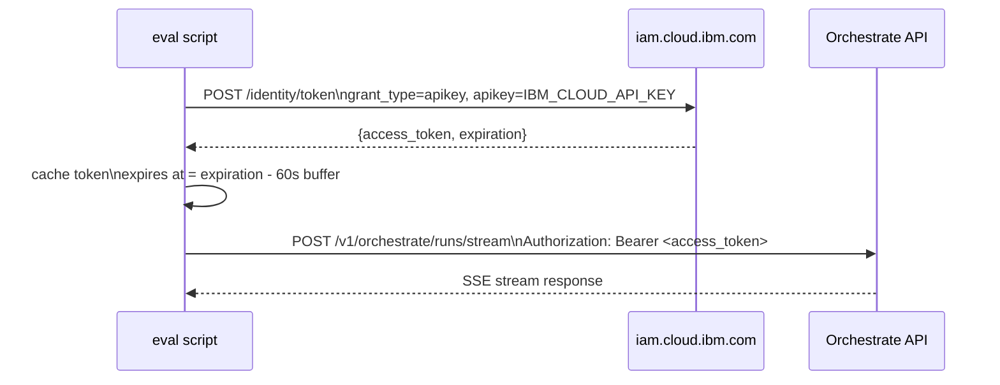

**Token caching:** Tokens are cached in memory on the `OrchestrateAgent` / `OrchestrateAgentV2` instance. A 60-second buffer before expiry ensures mid-run token refresh.

**Credential exposure protection:**
- `OrchestrateError` messages never include the bearer token or API key
- HTTP 401/403 errors produce: `"Orchestrate returned HTTP 401/403. Check ORCHESTRATE_AGENT_ID and IBM_CLOUD_API_KEY."` — no credential values
- `trust_env=False` prevents the IBM Cloud API key from being picked up by proxy env vars

### 3.6 Credentials Not in GitHub

`.gitignore` excludes:
```
.env          # All secrets
_stage/       # Staging dir built by register-toolkit.sh (may contain package code)
.venv/        # Virtual environment
venv/         # Alternate venv name
```

The `.env.example` file contains only placeholder comments for all credentials — no real values. **However**, one entry in `.env.example` appears to contain actual instance identifiers (not secrets, but specific to the deployment environment):

```
ORCHESTRATE_BASE_URL=https://api.ca-tor.watson-orchestrate.cloud.ibm.com/instances/4303637b-dfb5-4e34-ac7f-b2d23f901260
ORCHESTRATE_AGENT_ID=32a550ff-65df-426c-a710-7c524690d241
```

These are instance and agent UUIDs (not API keys), but they identify a specific Orchestrate deployment. A new deployment would need different values.

### 3.7 Security Limitations and Remaining Concerns

1. **No endpoint authentication on HTTP deploys.** Code Engine deployment is public. Must add auth layer for production.
2. **BLS API key rate limits.** v1 is 25 requests/day — easy to exhaust during active development. v2 is 500/day. Keys are free to register.
3. **No input sanitization beyond Pydantic.** Tool arguments are validated by Pydantic models, but complex free-text inputs (query strings) go directly to local search functions. These do not make outbound calls so injection risk is low.
4. **stdio process isolation.** The local MCP toolkit runs as a subprocess in Orchestrate's runtime. The security boundary between the subprocess and the Orchestrate platform is managed by IBM's infrastructure.
5. **Zscaler / TLS interception on GSA networks.** The `register-toolkit.sh` README documents a known issue where the GSA corporate network (Zscaler) intercepts TLS connections, causing `SSLCertVerificationError` in the ADK's IAM login. The fix is to merge Zscaler's root cert into the Python certifi bundle.

---

## 4. IBM watsonx Orchestrate Integration

### 4.1 Connection Method — The Method That Worked

After evaluating three deployment options, the team used the **local MCP toolkit (stdio)** method exclusively. This is documented in [`deploy/ibm/local-mcp-toolkit/`](deploy/ibm/local-mcp-toolkit/).

**Why this method was chosen:**
- No IBM Container Registry authority required
- No Code Engine project or container builds
- No public HTTP endpoint to secure
- Fastest iteration: code change → re-run register script → test in UI
- The BLS API key is handled cleanly via the `key_value` connection mechanism

**How it works:**

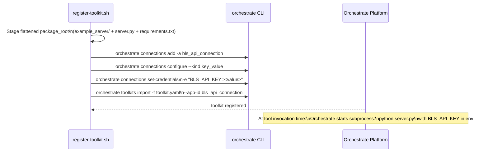

**Package staging:** The register script builds a temporary `_stage/` directory (git-ignored) containing:
- `example_server/` — flattened copy from `src/example_server/` (no `src/` prefix)
- `server.py` — stdio entrypoint that imports `mcp` from `example_server.app`
- `requirements.txt` — pinned runtime dependencies

This staging step is necessary because:
1. Uploading the whole repo (including `.venv/`) hits a 413 "Request Entity Too Large" error
2. The `src/` layout is not importable at Orchestrate's runtime without an install step
3. A `requirements.txt` at the `package_root` is how Orchestrate knows what to install

### 4.2 Toolkit Registration Details

**Toolkit name in Orchestrate:** `gsa_ds_bls_toolkit`

**Toolkit spec (`toolkit.yaml`):**
```yaml
spec_version: v1
kind: mcp
name: gsa_ds_bls_toolkit
command: python server.py
connections:
  - bls_api_connection
tools:
  - "*"    # All tools registered by the server
```

**Connection for BLS API key:**
```bash
orchestrate connections add -a bls_api_connection
orchestrate connections configure -a bls_api_connection --env draft --type team --kind key_value
orchestrate connections set-credentials -a bls_api_connection --env draft -e "BLS_API_KEY=<key>"
```

The `--app-id bls_api_connection` flag on `toolkits import` binds the connection to the toolkit. Orchestrate injects all key_value entries as environment variables into the stdio subprocess when it starts.

### 4.3 Agent Configuration

The agent spec is at [`deploy/ibm/agents/gsa_ds_bls_agent.yaml`](deploy/ibm/agents/gsa_ds_bls_agent.yaml).

**Key configuration:**
- `kind: native` — Orchestrate-native agent (not external)
- `llm: groq/openai/gpt-oss-120b` — the model selected after `list_models` during deployment
- `style: default` — standard react-style reasoning
- `tools:` — all 12 tools from `gsa_ds_bls_toolkit` listed explicitly

**The 12 tools registered:**
1. `gsa_ds_bls_toolkit:answer_bls_question`
2. `gsa_ds_bls_toolkit:suggest_series`
3. `gsa_ds_bls_toolkit:search_series`
4. `gsa_ds_bls_toolkit:build_series_id`
5. `gsa_ds_bls_toolkit:decode_series_id`
6. `gsa_ds_bls_toolkit:validate_series_id`
7. `gsa_ds_bls_toolkit:lookup_area_code`
8. `gsa_ds_bls_toolkit:lookup_industry_code`
9. `gsa_ds_bls_toolkit:get_series_metadata`
10. `gsa_ds_bls_toolkit:get_series_data`
11. `gsa_ds_bls_toolkit:list_resources` (synthetic — from ResourcesAsTools)
12. `gsa_ds_bls_toolkit:read_resource` (synthetic — from ResourcesAsTools)

**Agent instructions strategy:** The `instructions` field in the YAML contains a detailed tool selection guide with numbered priority rules, decision flowchart, and response format rules. Key directives:
- Use `answer_bls_question` as the PRIMARY tool for data questions (runs full pipeline)
- Use `suggest_series` for exploration when no series ID is known
- Never fabricate BLS data values
- Always cite "Source: U.S. Bureau of Labor Statistics"
- Flag preliminary (P) and revised (R) footnotes

### 4.4 Programmatic Agent Invocation (Eval Harness)

The eval harness invokes the deployed agent programmatically. Two approaches were developed:

**`agent.py` — Chat Completions endpoint:**
```
POST {ORCHESTRATE_BASE_URL}/v1/orchestrate/{agent_id}/chat/completions
Authorization: Bearer <IAM_token>
{"messages": [...], "stream": false}
```
- Returns the final answer text directly
- **Does NOT expose tool calls** — the agent's internal tool use is opaque
- Used by `run_experiment.py`

**`agent_v2.py` — SSE Streaming Runs endpoint (current):**
```
POST {ORCHESTRATE_BASE_URL}/v1/orchestrate/runs/stream
Authorization: Bearer <IAM_token>
{"agent_id": "...", "message": {"role": "user", "content": "..."}}
```
- Returns a Server-Sent Events stream
- **Exposes tool calls and tool responses** via `run.step.delta` events
- Enables `tool_call_count` metric in multi-run evaluation
- Used by `run_multi_eval.py`

**Why `agent_v2.py` was needed:** The `agent.py` chat completions endpoint was the original approach. It worked for getting answers but did not provide tool call metadata. The evaluation needed to measure `avg_tool_calls` to understand agent efficiency. The `/v1/orchestrate/runs/stream` endpoint was discovered to expose `run.step.delta` events that contain tool call names, arguments, and responses.

**URL format discovery challenge:** The `ORCHESTRATE_BASE_URL` has two valid formats depending on the endpoint:
- `https://ca-tor.watson-orchestrate.cloud.ibm.com` — for `/v1/orchestrate/{id}/chat/completions`
- `https://api.ca-tor.watson-orchestrate.cloud.ibm.com/instances/{instance_id}` — for `/v1/orchestrate/runs/stream`

The `.env.example` shows the full instance URL form, which is what `agent_v2.py` uses.

### 4.5 Challenges and Troubleshooting

**Challenge 1 — Zscaler TLS interception:** On GSA corporate networks, the Orchestrate ADK CLI failed with `SSLCertVerificationError`. Resolution: export Zscaler root certs, merge with certifi bundle, set `SSL_CERT_FILE` and `REQUESTS_CA_BUNDLE` environment variables before running the register script.

**Challenge 2 — Package staging 413 error:** Initial attempts to upload the full repo directory as `package_root` failed with HTTP 413. Resolution: the `_stage/` flattening approach described in Section 4.1.

**Challenge 3 — `src/` layout not importable:** The `example_server` package lives in `src/example_server/`, which requires the package to be installed (`pip install -e .`) or for `src/` to be on `sys.path`. Orchestrate's runtime does neither. Resolution: flatten the package directly at `package_root` level in the staging directory.

**Challenge 4 — Tool call count not visible:** The initial `agent.py` using the chat completions endpoint returns only the final answer text. Tool calls happen inside Orchestrate and are not visible. Resolution: `agent_v2.py` using the SSE streaming endpoint exposes `run.step.delta` events with tool call metadata.

**Challenge 5 — Phoenix instrumentation not capturing tool calls:** `LangChainInstrumentor` instruments LangChain's internal chains and tools. Since the agent runs entirely inside Orchestrate (the eval harness is just calling an API), LangChain is not in the execution path. Tool call spans are not captured in Phoenix. Resolution: collect tool call counts directly from the SSE events in `agent_v2.py.last_run_result.tool_calls` rather than from Phoenix traces.

### 4.6 Complete Backend Deployment — Every Command and File

This section documents **exactly** what commands were run on the backend, what files were created or modified, and what environment variables were set during the deployment process. This is the information that cannot be inferred from the codebase alone.

#### Step 0 — Prerequisites

```bash
# 1. Install the watsonx Orchestrate ADK
pip install --upgrade ibm-watsonx-orchestrate
orchestrate --version   # must succeed

# 2. Confirm Python and uv
python --version        # 3.11+
uv --version

# 3. Have a copy of the repo checked out locally
# and have the BLS API key ready (from https://data.bls.gov/registrationEngine/)
```

#### Step 1 — Configure the deployment env file

```bash
# Copy the template
cp deploy/ibm/local-mcp-toolkit/.env.example deploy/ibm/local-mcp-toolkit/.env

# Edit the file — only two non-secret values needed:
# WXO_ENV_NAME=gsa-hackathon          # arbitrary label for the ADK environment
# WXO_INSTANCE_URL=https://api.ca-tor.watson-orchestrate.cloud.ibm.com/instances/<your-id>
# TOOLKIT_NAME=gsa_ds_bls_toolkit     # leave as-is to match the agent YAML

# The .env.example already has TOOLKIT_NAME pre-set
# Source it into the shell
set -a; source deploy/ibm/local-mcp-toolkit/.env; set +a
```

**Files created:** `deploy/ibm/local-mcp-toolkit/.env` (git-ignored, never committed)

#### Step 2 — Provide API keys (never stored in files)

```bash
# Option A — set as env vars before running the script
export WXO_API_KEY="<your watsonx Orchestrate API key>"
export BLS_API_KEY="<your BLS registration key>"

# Option B — leave unset; the script prompts for each with hidden input
# (the script uses `read -r -s` for all secret prompts)
```

**Where to find these keys:**
- `WXO_API_KEY`: IBM Cloud console → Resource List → your watsonx Orchestrate instance → Service credentials → Create credential → `apikey` field
- `BLS_API_KEY`: https://data.bls.gov/registrationEngine/ (free registration)

#### Step 3 — Run the register script

```bash
bash deploy/ibm/local-mcp-toolkit/register-toolkit.sh
```

**What the script does internally (each step is idempotent):**

```bash
# 3a. Add or reuse the ADK environment
orchestrate env add --name gsa-hackathon \
    --url https://api.ca-tor.watson-orchestrate.cloud.ibm.com/instances/<id> \
    --type ibm_iam
orchestrate env activate gsa-hackathon --api-key <WXO_API_KEY>

# 3b. Create the BLS API key connection (or update if it already exists)
orchestrate connections add -a bls_api_connection
orchestrate connections configure -a bls_api_connection \
    --env draft --type team --kind key_value
orchestrate connections configure -a bls_api_connection \
    --env live  --type team --kind key_value
orchestrate connections set-credentials -a bls_api_connection \
    --env draft -e "BLS_API_KEY=<value>"
orchestrate connections set-credentials -a bls_api_connection \
    --env live  -e "BLS_API_KEY=<value>"

# 3c. Build the staging directory (temporary, git-ignored)
# Creates: deploy/ibm/local-mcp-toolkit/_stage/
#   _stage/example_server/   <- copy of src/example_server/
#   _stage/server.py         <- the stdio entrypoint
#   _stage/requirements.txt  <- fastmcp, httpx, pydantic, pydantic-settings

# 3d. Generate a temporary toolkit YAML pointing at the staging dir
# Creates: deploy/ibm/local-mcp-toolkit/_toolkit.generated.yaml
# (identical to toolkit.yaml but with package_root set to the _stage/ absolute path)

# 3e. Remove any old version of the toolkit, then import the new one
orchestrate toolkits remove --name gsa_ds_bls_toolkit   # if it exists
orchestrate toolkits import -f _toolkit.generated.yaml \
    --app-id bls_api_connection

# 3f. Clean up temporary files
rm -rf _stage/ _toolkit.generated.yaml

# 3g. Confirm
orchestrate toolkits list
```

**Files created by the script (all temporary or git-ignored):**
- `deploy/ibm/local-mcp-toolkit/_stage/` — staging directory (auto-deleted after import)
- `deploy/ibm/local-mcp-toolkit/_toolkit.generated.yaml` — ephemeral toolkit spec (auto-deleted after import)

**Orchestrate platform objects created:**
- `bls_api_connection` — `key_value` connection storing `BLS_API_KEY` for draft and live environments
- `gsa_ds_bls_toolkit` — local MCP toolkit with 12 tools registered

#### Step 4 — Import the agent

The agent YAML is committed to the repo at [`deploy/ibm/agents/gsa_ds_bls_agent.yaml`](deploy/ibm/agents/gsa_ds_bls_agent.yaml).

```bash
# Import the primary BLS agent
orchestrate agents import -f deploy/ibm/agents/gsa_ds_bls_agent.yaml

# Import the no-tool baseline agent (for eval comparison)
orchestrate agents import -f deploy/ibm/agents/gsa_ds_bls_baseline_agent.yaml

# Confirm both agents are registered
orchestrate agents list
```

**What the agent YAML specifies:**
- `kind: native` — a native Orchestrate agent (not an external system)
- `name: gsa_ds_bls_agent` — the name shown in the Orchestrate UI and used by the eval harness
- `llm: groq/openai/gpt-oss-120b` — the model; this was chosen after running `orchestrate models list` and selecting the best available option at deployment time
- `tools:` — all 12 toolkit tools listed with the `gsa_ds_bls_toolkit:` prefix
- `instructions:` — the full inline agent prompt (see Section 4.3)

**Orchestrate platform objects created:**
- `gsa_ds_bls_agent` — primary agent with 12 tools; UUID visible in the Orchestrate UI
- `gsa_ds_bls_baseline_agent` — no-tool comparison agent

#### Step 5 — Retrieve the agent UUID for the eval harness

After import, the agent UUID is visible in the Orchestrate UI:
1. Open the Orchestrate UI → Agents
2. Find `gsa_ds_bls_agent` → click it
3. The UUID appears in the browser URL: `.../agents/<UUID>/...`

Alternatively, extract it programmatically:
```bash
orchestrate agents list --verbose | grep -A5 gsa_ds_bls_agent
```

Then set it in `.env`:
```
ORCHESTRATE_AGENT_ID=<UUID from above>
ORCHESTRATE_BASE_URL=https://api.ca-tor.watson-orchestrate.cloud.ibm.com/instances/<instance-id>
IBM_CLOUD_API_KEY=<same key used as WXO_API_KEY>
```

#### Step 6 — Verify deployment

```bash
# Smoke-test the agent connection (from eval/phoenix/):
cd eval/phoenix
uv run python agent_v2.py
# Expected output:
# Question: What BLS series covers the national unemployment rate?
# Answer:   LNS14000000
# Tool calls (1):
#   answer_bls_question({...})
```

#### All `.env` files in the repo — what each controls

| File | Committed? | What it configures |
|---|---|---|
| `.env.example` (root) | ✅ Yes (no secrets) | Documents all runtime env vars: MCP transport, BLS API key, Orchestrate credentials, watsonx.ai eval credentials |
| `.env` (root) | ❌ No (git-ignored) | Actual values for local dev and eval: `BLS_API_KEY`, `IBM_CLOUD_API_KEY`, `ORCHESTRATE_BASE_URL`, `ORCHESTRATE_AGENT_ID`, `WATSONX_API_KEY`, `WATSONX_URL`, `WATSONX_PROJECT_ID` |
| `deploy/ibm/local-mcp-toolkit/.env.example` | ✅ Yes (no secrets) | Toolkit deployment coordinates: `WXO_INSTANCE_URL`, `WXO_ENV_NAME`, `TOOLKIT_NAME` |
| `deploy/ibm/local-mcp-toolkit/.env` | ❌ No (git-ignored) | Actual `WXO_INSTANCE_URL` for the deployment; no secrets |
| `deploy/ibm/code-engine-git-build/.env.example` | ✅ Yes (no secrets) | Code Engine build coordinates: region, resource group, project, app name, ICR details |
| `deploy/ibm/code-engine-git-build/.env` | ❌ No (git-ignored) | Actual Code Engine values (unused in this project) |
| `deploy/ibm/prebuilt-image/.env.example` | ✅ Yes (no secrets) | Prebuilt image deploy coordinates (unused in this project) |

**The root `.env` is the master secrets file.** All tools, scripts, and eval code load it via `load_dotenv()` or `pydantic-settings` automatic `.env` file detection. The `eval/phoenix/` scripts call `load_dotenv(_repo_root / ".env")` with an explicit absolute path so they work correctly when run from any subdirectory.

#### All files in `deploy/ibm/local-mcp-toolkit/` — what each does

| File | Committed? | Purpose |
|---|---|---|
| `server.py` | ✅ Yes | Stdio entrypoint. Adds `_stage/` dir to `sys.path`, imports `example_server.app:mcp`, calls `mcp.run(transport="stdio")`. This is what Orchestrate's `python server.py` command runs. |
| `requirements.txt` | ✅ Yes | Runtime dependencies installed by Orchestrate at toolkit import time: `fastmcp>=2.0.0`, `httpx>=0.27.0`, `pydantic>=2.0.0`, `pydantic-settings>=2.0.0`. Note: `pandas` is in `pyproject.toml` but not here — it is not needed at runtime. |
| `toolkit.yaml` | ✅ Yes | Template toolkit import spec. The register script copies this and rewrites `package_root` to the absolute staging path before importing. Contains the `name`, `command`, `connections`, and `tools: ["*"]` fields. |
| `register-toolkit.sh` | ✅ Yes | Idempotent registration script. Run from the repo root after sourcing `.env`. Handles: ADK env setup, connection create/update, package staging, toolkit import, cleanup. |
| `.env.example` | ✅ Yes | Deployment coordinate template. `WXO_INSTANCE_URL` is the only field that must be customized. |
| `.env` | ❌ No | Actual deployment coordinates. Git-ignored. Contains no secrets — only the instance URL. |
| `_stage/` | ❌ No (git-ignored) | Temporary staging directory created and deleted by the register script. Never committed. |
| `_toolkit.generated.yaml` | ❌ No (git-ignored) | Ephemeral generated YAML. Created by the register script's `sed` replacement and deleted after import. Never committed. |

---

## 5. Evaluation Harness

### 5.1 Architecture and Design

The evaluation harness in `eval/phoenix/` measures how well the deployed `gsa_ds_bls_agent` answers BLS data questions. It uses **Arize Phoenix** for experiment tracking and **LLM-as-judge** evaluators running on watsonx.ai.

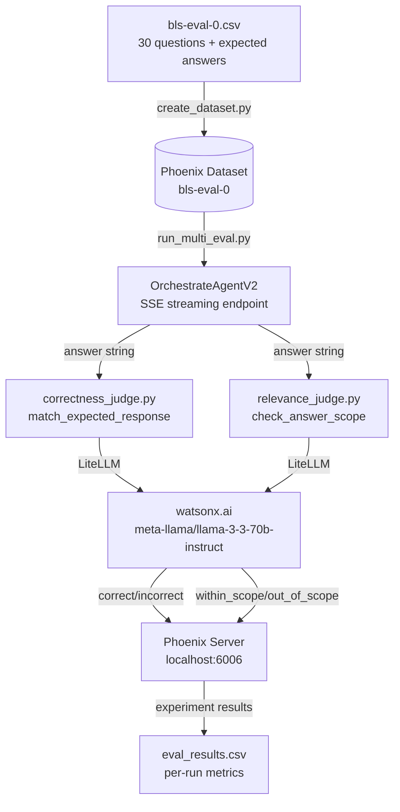

### 5.2 Dataset

**File:** [`eval/phoenix/datasets/bls-eval-0/examples/bls-eval-0.csv`](eval/phoenix/datasets/bls-eval-0/examples/bls-eval-0.csv)

**30 questions** covering 5 categories:
- **Discovery (6 questions):** "What BLS series covers...?", "Suggest a series for..."
- **Series identity (6 questions):** Survey lookup, SA status, unit of measurement, measure type
- **Construction (6 questions):** Area codes, industry codes, building series IDs
- **Live data (8 questions):** Actual BLS values requiring API calls (unemployment rates, CPI values, payroll counts)
- **Out-of-scope refusal (4 questions):** GDP, Federal Reserve rates, stock market — should be declined

**Data freshness note:** Live data answers were verified against the BLS Public Data API with `end_year=2026`. BLS publishes annual benchmark revisions that can change historical values. The dataset should be re-verified annually.

### 5.3 Evaluators

**Correctness judge (`judges/correctness_judge.py`):**
- Function: `match_expected_response(input, output, expected) -> "correct" | "incorrect"`
- Model: `meta-llama/llama-3-3-70b-instruct` via LiteLLM watsonx provider
- Scoring rules: numeric match ignores units/prose; series ID match is case-insensitive; description match allows abbreviations; additional correct context = correct; refused answer when reference gives value = incorrect

**Scope judge (`judges/relevance_judge.py`):**
- Function: `check_answer_scope(input, output) -> "within_scope" | "out_of_scope"`
- Model: same as correctness judge
- Scoring rules: in-scope + answered = within_scope; out-of-scope + declined = within_scope; in-scope + refused = out_of_scope; out-of-scope + answered = out_of_scope

**LiteLLM integration:** Both judges call `litellm.completion(model="watsonx/<model_id>", ...)`. LiteLLM handles the watsonx.ai authentication automatically using `WATSONX_API_KEY`, `WATSONX_URL`, and `WATSONX_PROJECT_ID` environment variables.

**Judge prompt design:** The templates include an important date-awareness instruction:
> "IMPORTANT: BLS publishes historical data records. All questions about dates through 2025 refer to published historical data."

This prevents the judge from incorrectly marking correct answers as "out_of_scope" because it thinks the question is asking for a forecast.

### 5.4 Evaluation Script Inventory — What Each File Does and How They Differ

There are five Python scripts in `eval/phoenix/`. They serve different purposes and went through significant evolution. This section explains each one, how they relate, and what changed over time.

#### `create_dataset.py` — Upload question set to Phoenix (run once)

Reads `datasets.yaml` to find the CSV path, validates it has the required `query` and `responses` columns, and uploads it to the local Phoenix server via `phoenix.client.Client.datasets.create_dataset()`. This is a one-time setup step per machine. The dataset is versioned in Phoenix so experiments always run against the same question set.

```bash
uv run create_dataset.py --dataset-name bls-eval-0        # upload
uv run create_dataset.py --dataset-name bls-eval-0 --dry-run   # validate only
uv run create_dataset.py --list                            # list registered datasets
```

#### `run_experiment.py` — Single experiment run (original script)

The original evaluation driver. Uses `agent.py` (chat completions endpoint, v1 agent). Runs the full dataset once, logs every question-answer-score triple to Phoenix, prints the experiment ID. Used for one-off runs and A/B testing system prompt versions.

```bash
uv run run_experiment.py --dataset-name bls-eval-0
uv run run_experiment.py --dataset-name bls-eval-0 --system-prompt-version v2
```

**Limitation:** `agent.py` uses the chat completions endpoint, which does not expose tool calls. The `avg_tool_calls` metric cannot be measured with this script.

#### `run_baseline.py` — No-tool baseline (two iterations)

**Iteration 1 (commit `3e5b97d`):** The original version called `litellm.completion()` directly with the same judge model — no Orchestrate, no agent, just a plain LLM answering from training knowledge. It used `watsonx/<model>` via LiteLLM with a brief system prompt: `"Answer as accurately as you can from your training knowledge."` This measured the pure LLM floor.

**Iteration 2 (commit `22d32c2`):** Rewritten to use the **deployed `gsa_ds_bls_baseline_agent` in Orchestrate** instead of a direct LLM call. This change was made because:
- The plain LLM and the tool-augmented agent were using different models in different environments, making the comparison less clean
- Using the same model (`groq/openai/gpt-oss-120b`) in Orchestrate for both agents guarantees the only difference is tool access
- The baseline agent YAML was added to the repo at the same time (`deploy/ibm/agents/gsa_ds_bls_baseline_agent.yaml`)

The rewritten `run_baseline.py` imports and uses `OrchestrateAgent` (from `agent.py`) with `ORCHESTRATE_AGENT_ID` overridden to the baseline agent's UUID.

```bash
uv run run_baseline.py --dataset-name bls-eval-0
# Requires ORCHESTRATE_BASELINE_AGENT_ID in .env
```

#### `run_multi_eval.py` — N-run aggregated evaluation (current primary script)

The most capable script. Added after the team realized that single-run scores varied significantly due to LLM non-determinism — a single run was not a reliable estimate of the agent's true performance.

**Key capabilities vs `run_experiment.py`:**
- Uses `agent_v2.py` (SSE streaming endpoint) instead of `agent.py` — this enables the `avg_tool_calls` metric
- Runs N times (default 5), captures per-run metrics, computes an AVERAGE summary row
- Writes a CSV with one row per run + the AVERAGE row
- Prints a fixed-width summary table to stdout after all runs complete

**`--baseline` flag (added in commit `e820018`):** The major update that unified tool and baseline evaluation into one script. Before this change, baseline evaluation required a separate `run_baseline.py` invocation. After the change, both can be run from `run_multi_eval.py`:

```bash
# Run the tool-augmented agent (default)
uv run run_multi_eval.py --dataset-name bls-eval-0 --runs 5

# Run the no-tool baseline agent
uv run run_multi_eval.py --dataset-name bls-eval-0 --runs 5 --baseline

# Run baseline with explicit UUID (overrides default hardcoded value)
uv run run_multi_eval.py --dataset-name bls-eval-0 --baseline \
    --baseline-agent-id 05ae1efe-2067-4aae-a6f7-fd111a7517d5
```

When `--baseline` is set, `run_multi_eval.py`:
1. Calls `_check_env(baseline=True)` which requires `ORCHESTRATE_BASELINE_AGENT_ID` instead of `ORCHESTRATE_AGENT_ID`
2. Sets `os.environ["ORCHESTRATE_AGENT_ID"] = args.baseline_agent_id` before creating the agent — `OrchestrateAgentV2` reads `ORCHESTRATE_AGENT_ID` at construction time
3. Changes the `run_tag` to `"baseline"` so experiment names in Phoenix are `bls-eval-0-baseline-run1`, distinguishable from `bls-eval-0-v1-run1`
4. Prints `Agent: baseline (05ae1efe...)` in the run header for visibility

**How the baseline agent was created:** A second native Orchestrate agent (`gsa_ds_bls_baseline_agent`) was imported using its own YAML spec. It uses the same LLM as the primary agent (`groq/openai/gpt-oss-120b`) but has **no tools** in the `tools:` list. Its instructions are minimal: answer from training knowledge, don't fabricate statistics. This ensures the only variable between the two agents is tool access — the model, platform, and question set are identical.

#### `agent.py` vs `agent_v2.py` — Two API endpoint strategies

| | `agent.py` | `agent_v2.py` |
|---|---|---|
| Endpoint | `/v1/orchestrate/{id}/chat/completions` | `/v1/orchestrate/runs/stream` |
| Response | Blocking JSON | SSE event stream |
| Tool calls visible | ❌ No | ✅ Yes (via `run.step.delta` events) |
| `avg_tool_calls` | ❌ Always "N/A" | ✅ Captured per run |
| Used by | `run_experiment.py`, `run_baseline.py` | `run_multi_eval.py` |
| URL format | Short form: `https://ca-tor.watson-orchestrate.cloud.ibm.com` | Long form with instance ID |

The SSE stream from `agent_v2.py` emits events with types `message.delta` (answer chunks) and `run.step.delta` (tool calls + tool responses). The agent parses these into a `RunResult` dataclass containing both the final answer string and the list of tool calls, enabling the `tool_call_count` property.

#### Full workflow diagram

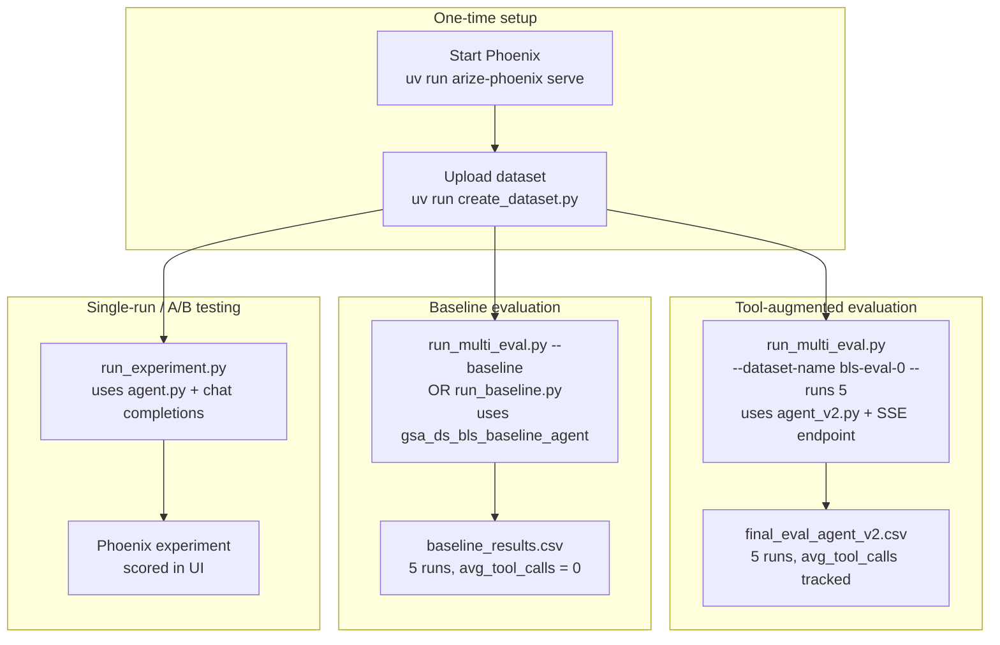

### 5.5 Final Evaluation Results

**Tool-augmented agent (`gsa_ds_bls_agent`) — 5 runs** (source: [`eval/phoenix/final_eval_agent_v2.csv`](eval/phoenix/final_eval_agent_v2.csv)):

| Run | Correctness | Scope Adherence | Avg Latency | P95 Latency | Avg Tool Calls |
|---|---|---|---|---|---|
| 1 | 66.7% | 96.7% | 11.80s | 29.90s | 1.00 |
| 2 | 76.7% | 96.7% | 13.05s | 32.45s | 1.07 |
| 3 | 73.3% | 96.7% | 13.65s | 48.96s | 0.97 |
| 4 | 70.0% | 96.7% | 11.79s | 23.65s | 0.97 |
| 5 | 70.0% | 93.3% | 13.00s | 39.39s | 1.07 |
| **AVERAGE** | **71.3%** | **96.0%** | **12.66s** | **34.87s** | **1.02** |

**No-tool baseline (`gsa_ds_bls_baseline_agent`) — 5 runs** (source: [`eval/phoenix/baseline_results.csv`](eval/phoenix/baseline_results.csv)):

| Run | Correctness | Scope Adherence | Avg Latency | P95 Latency | Avg Tool Calls |
|---|---|---|---|---|---|
| 1 | 40.0% | 96.7% | 3.73s | 8.28s | 0 |
| 2 | 40.0% | 96.7% | 3.90s | 8.80s | 0 |
| 3 | 46.7% | 96.7% | 4.11s | 8.27s | 0 |
| 4 | 33.3% | 100.0% | 3.47s | 7.91s | 0 |
| 5 | 43.3% | 96.7% | 4.11s | 7.78s | 0 |
| **AVERAGE** | **40.7%** | **97.3%** | **3.87s** | **8.21s** | **0** |

> **Note:** The baseline results were re-run after migrating from the original direct-LLM approach (commit `3e5b97d`) to the deployed Orchestrate baseline agent (commit `22d32c2`). The earlier baseline results (`85e243e add baseline results`) showed 36.7% correctness; the current file shows **40.7%** — the improvement reflects using the same, stronger model (`groq/openai/gpt-oss-120b`) consistently in both agents rather than a weaker LiteLLM direct call.

**Key findings:**
- Tool augmentation improves correctness from 40.7% → 71.3% (+30.6 percentage points = **~1.75x lift**)
- Scope adherence is equivalent between both agents (~96–97%), confirming the model understands out-of-scope boundaries without tool access
- Baseline `avg_tool_calls = 0` confirms the baseline agent truly has no tool access
- Average tool call count of ~1.02 for the tool agent means most questions resolve in a single tool call — `answer_bls_question` runs the full pipeline internally
- Latency is ~3.3× higher with tools (12.66s vs 3.87s) due to tool execution time and BLS API round trips
- P95 latency is high (34.87s vs 8.21s) — the long tail comes from questions that trigger BLS API calls for multi-year date ranges

**Remaining correctness failures (~28.7%):** Primarily affect:
- Complex series ID construction questions requiring multi-step lookup
- Questions about specific recent data where BLS data may have been revised
- Some ambiguous questions where the agent picks a reasonable but non-reference series

### 5.6 Arize Phoenix Integration

Phoenix serves two purposes:
1. **Experiment tracking:** Stores datasets, task results, and evaluator scores; provides a UI for inspecting individual question-answer pairs
2. **Trace collection:** Collects OTLP traces via `phoenix_register()` and `LangChainInstrumentor`

**Phoenix setup in agent code:**
```python
def initialize(self) -> None:
    tracer_provider = phoenix_register(
        project_name="bls-eval",
        endpoint="http://localhost:6006/v1/traces",
        auto_instrument=True,
    )
    LangChainInstrumentor().instrument(tracer_provider=tracer_provider)
```

**Instrumentation limitation:** `LangChainInstrumentor` captures LangChain chains and tools. Since the agent runs entirely inside Orchestrate (the eval harness only makes HTTP calls to the Orchestrate API), LangChain is not in the execution path. **Tool call spans are NOT captured in Phoenix traces.** Tool call metadata is instead extracted from the SSE stream in `agent_v2.py`.

**Phoenix query script:** [`phoenix_query.py`](phoenix_query.py) in the repo root provides a utility for filtering and exporting experiment results from Phoenix programmatically.

### 5.7 Troubleshooting History

**Issue: Phoenix `run_experiment` API signature changed**
- Commit `6091e31` fixed alignment between the Phoenix client API and `run_experiment()` / `create_dataset()` calls after a package version update
- The `phoenix.client.Client` API for `datasets.get_dataset()` and `experiments.run_experiment()` changed between releases

**Issue: Judges used wrong LiteLLM model format**
- Commit `d83abb7` ("rewrite judges to use litellm directly, fix phoenix evals API") rewrote judges to use `litellm.completion(model="watsonx/<id>")` directly instead of LangChain wrappers
- The original LangChain-based judge approach had issues with the watsonx provider authentication in the evaluation context

**Issue: `avg_tool_calls` always "N/A"**
- Original `agent.py` using chat completions endpoint cannot observe tool calls
- Resolution: implemented `agent_v2.py` using SSE streaming endpoint which exposes `run.step.delta` events with tool call details
- Commit `8fa8b74` ("Adjusted agent.py to another called agent_v2.py which adds tool count from orchestrate")

**Issue: Date-pinning causing "no data" errors**
- Commit `eefc5cf` ("auto-inject current year as end_year to prevent false 'no data' on recent years") added logic to default `end_year` to `datetime.date.today().year` when not specified
- The BLS API default window (last 3 years) sometimes missed current-year data when queried in the first month of a new year

**Issue: LN series length not capped at 18 chars**
- Commit `93ace1a` fixed a bug where the series ID validator was incorrectly enforcing an 18-character cap on all series IDs, causing valid LN (CPS) series IDs to fail validation

---

## 6. Setup, Maintenance, and Handoff

### 6.1 Prerequisites

- Python 3.11+ (project uses 3.13 in `.python-version`)
- `uv` package manager: `pip install uv` or `brew install uv`
- IBM Cloud account with watsonx Orchestrate instance (for deployment/eval)
- BLS API key (optional but recommended): https://data.bls.gov/registrationEngine/

### 6.2 Local Development Setup

```bash
# 1. Clone the repo
git clone https://github.com/<org>/gsa_mcp_hackathon.git
cd gsa_mcp_hackathon

# 2. Copy and configure environment variables
cp .env.example .env
# Edit .env — set BLS_API_KEY if you have one
# Set IBM_CLOUD_API_KEY, ORCHESTRATE_BASE_URL, ORCHESTRATE_AGENT_ID for eval

# 3. Install dependencies
uv sync              # runtime deps only
uv sync --group dev  # + eval/test/lint deps

# 4. Run the server locally (stdio mode)
uv run python main.py
# Server starts and waits for MCP client over stdin/stdout

# 5. Run tests
uv run pytest tests/ -v

# 6. Lint
uv run ruff check .
uv run ruff format --check .
```

### 6.3 Running the MCP Server in HTTP Mode

```bash
# Local HTTP mode for testing the HTTP transport
MCP_TRANSPORT=streamable-http uv run python main.py

# In another terminal:
curl http://localhost:8000/health
# → {"status": "healthy", ...}
```

### 6.4 Deploying to watsonx Orchestrate (Local MCP Toolkit)

```bash
# 1. Install the ADK
pip install --upgrade ibm-watsonx-orchestrate
orchestrate --version

# 2. Configure the toolkit env
cp deploy/ibm/local-mcp-toolkit/.env.example deploy/ibm/local-mcp-toolkit/.env
# Edit: set WXO_INSTANCE_URL to your Orchestrate instance URL
#       WXO_ENV_NAME (e.g. "bls-mcp-prod")
#       TOOLKIT_NAME (e.g. "gsa_ds_bls_toolkit")

# 3. Source the config
set -a; source deploy/ibm/local-mcp-toolkit/.env; set +a

# 4. Run the register script
# Provide keys either via env vars or when prompted (hidden input)
export WXO_API_KEY="<your orchestrate API key>"
export BLS_API_KEY="<your BLS registration key>"  # or leave blank for v1
bash deploy/ibm/local-mcp-toolkit/register-toolkit.sh

# If on GSA corporate network with Zscaler:
export SSL_CERT_FILE=/tmp/wxo-ca-bundle.pem
export REQUESTS_CA_BUNDLE=/tmp/wxo-ca-bundle.pem
# (see deploy/ibm/local-mcp-toolkit/README.md Section 2.2a for cert bundle instructions)
```

### 6.5 Importing the Agent to Orchestrate

```bash
# Using the ADK (after environment is activated):
orchestrate agents import -f deploy/ibm/agents/gsa_ds_bls_agent.yaml

# Verify:
orchestrate agents list

# Also import the baseline agent for eval comparison:
orchestrate agents import -f deploy/ibm/agents/gsa_ds_bls_baseline_agent.yaml
```

### 6.6 Running the Evaluation Harness

```bash
# Change to eval directory
cd eval/phoenix/

# 1. Start Phoenix (UI at http://localhost:6006)
uv run arize-phoenix serve

# 2. Upload the dataset (one-time per machine/Phoenix instance)
uv run create_dataset.py --dataset-name bls-eval-0

# Validate without uploading:
uv run create_dataset.py --dataset-name bls-eval-0 --dry-run

# 3. Run the multi-run evaluation (5 runs, default)
uv run run_multi_eval.py --dataset-name bls-eval-0

# With options:
uv run run_multi_eval.py \
    --dataset-name bls-eval-0 \
    --runs 3 \
    --system-prompt-version v2 \
    --output my_results.csv

# 4. Run the no-tool baseline for comparison
uv run run_baseline.py --dataset-name bls-eval-0

# 5. Smoke test agent connectivity (before running full eval)
cd eval/phoenix && uv run python agent_v2.py
# Should print "Answer: 3.7" for January 2024 unemployment question
```

**Required env vars for evaluation:**
```
ORCHESTRATE_BASE_URL   # e.g. https://api.ca-tor.watson-orchestrate.cloud.ibm.com/instances/<id>
ORCHESTRATE_AGENT_ID   # UUID of gsa_ds_bls_agent (from Orchestrate UI)
IBM_CLOUD_API_KEY      # IBM Cloud API key for IAM token exchange
WATSONX_API_KEY        # Same IBM Cloud API key (LiteLLM watsonx provider)
WATSONX_URL            # watsonx.ai regional endpoint (e.g. https://us-south.ml.cloud.ibm.com)
WATSONX_PROJECT_ID     # watsonx.ai project ID
JUDGE_MODEL            # optional; default: meta-llama/llama-3-3-70b-instruct
```

### 6.7 Major Technical Decisions and Tradeoffs

**Decision 1: Local MCP toolkit over HTTP deployment**
- Chosen: stdio local toolkit
- Alternative: HTTP deployment on Code Engine
- Tradeoff: Simpler setup, no network auth concerns, but requires the register script to be run from a machine with the ADK and repo checked out. The stdio process-per-invocation adds ~100-300ms startup latency per tool call.

**Decision 2: `answer_bls_question` as a high-level orchestrator**
- Chosen: One tool that runs the full discovery → check → fetch pipeline internally
- Alternative: Have the agent call individual tools in sequence
- Tradeoff: Reduces agent reasoning load and minimizes multi-turn failures, but makes the internal pipeline less transparent to the agent. The agent can still call lower-level tools directly for specialized tasks.

**Decision 3: Ambiguity detection before API calls**
- Chosen: Block API calls when measure_type candidates conflict; clarify before fetching
- Alternative: Always fetch with a reasonable default; let the agent decide
- Tradeoff: Prevents silent wrong-series fetches (e.g., returning employment level when user asked for unemployment rate) at the cost of additional round trips for clarification.

**Decision 4: Local-cache over live API for catalog lookups**
- Chosen: Download BLS reference files and load at import time
- Alternative: Query BLS catalog API for each lookup
- Tradeoff: No network dependency for discovery and metadata operations; faster; but requires periodic refresh of local-cache files when BLS updates catalog data.

**Decision 5: `agent_v2.py` SSE endpoint over chat completions**
- Chosen: `/v1/orchestrate/runs/stream` SSE endpoint
- Alternative: `/v1/orchestrate/{id}/chat/completions`
- Tradeoff: SSE endpoint exposes tool call metadata (enabling `avg_tool_calls` metric) but requires parsing a streaming event format and is more complex. Chat completions is simpler but opaque regarding tool use.

**Decision 6: LiteLLM for judges over LangChain-watsonx**
- Chosen: `litellm.completion(model="watsonx/<id>")`
- Alternative: `langchain_ibm.WatsonxLLM`
- Tradeoff: LiteLLM has cleaner watsonx authentication via standard env vars; LangChain-watsonx required additional setup and had version compatibility issues during the eval.

### 6.8 Known Issues and Unresolved Problems

1. **Phoenix traces don't capture tool calls.** `LangChainInstrumentor` has nothing to instrument because the agent runs in Orchestrate, not locally. Tool call data is captured via SSE events only.

2. **~28.7% correctness gap.** The agent fails on some complex multi-step constructions and questions requiring specific recent data values. Root causes to investigate: agent needs to call `get_series_metadata` before `get_series_data` for LN series (documented in `system_prompt_v2.txt` as CRITICAL CONVENTION #2).

3. **Avg tool calls ~1.02.** This is suspiciously low for 30 questions where many should require 2+ tool calls (suggest → fetch). This may indicate the agent is using `answer_bls_question` for most questions (which runs the full pipeline internally and counts as 1 tool call).

4. **P95 latency is high (34.87s).** Some questions trigger slow BLS API responses. The timeout in `fetch_bls()` is 30 seconds — close to the P95. Consider increasing to 60 seconds for complex multi-series requests.

5. **Local-cache files need periodic refresh.** BLS updates area and industry codes. The `local-cache/` files should be re-downloaded from `https://download.bls.gov/pub/time.series/<survey>/` annually.

6. **`example_tool.py` and `resources/example.py` still registered.** The plan to deregister these stubs (`bls-mcp-integration-plan.md` Sub-Task 2) was planned but not executed. They add noise to the tool list. The `example_search_datasets` tool would appear as the 13th tool — it's harmless but confusing.

### 6.9 Recommended Next Steps

**Immediate:**
1. Update `tools/__init__.py` to remove `example_tool.register(mcp)` and `resources/__init__.py` to remove `example.register(mcp)` — reduces tool list noise for the agent
2. Update `.env.example` to remove the hardcoded instance URL and agent UUID (or add a comment explaining they are environment-specific)
3. Verify the BLS API key in the `bls_api_connection` is still valid (keys don't expire but can be rotated)

**Short-term:**
4. Run the eval with `--system-prompt-version v2` and compare to v1 results — v2 adds explicit scope boundary instructions that should improve the failing out-of-scope cases
5. Add more questions to `bls-eval-0.csv` covering LN survey series (the `get_series_metadata` convention is documented but not evaluated)
6. Investigate whether `avg_tool_calls ~1` indicates the agent is over-relying on `answer_bls_question` and skipping lower-level tools when they would be more appropriate

**Longer-term:**
7. HTTP deployment via Code Engine for a persistent public endpoint
8. Add authentication to the HTTP endpoint (e.g., IBM App ID or API key header)
9. Expand the flagship series table — the current 12-survey coverage has gaps in less common series
10. Automate local-cache refresh from BLS download server

### 6.10 Guidance for Continuing AI Agent Development

**To continue working in this codebase:**

1. **Start Phoenix before any eval work:** `uv run arize-phoenix serve` from `eval/phoenix/`

2. **Never hardcode BLS series IDs in agent instructions.** Series IDs can change with survey restructuring. Use `suggest_series` or `search_series` to discover them.

3. **Test tool changes with the smoke test before full eval:**
   ```bash
   cd eval/phoenix && uv run python agent_v2.py
   ```

4. **The `answer_bls_question` tool is the agent's primary interface.** Most correctness improvements will come from improving the pipeline in `tools/answer_bls_question.py` and `ambiguity.py`, not from adding new tools.

5. **Understand the ambiguity module before modifying tools.** The `answer_bls_question → ambiguity → fetch` pipeline has 13 documented findings in `bls-ambiguity-implementation-plan.md`. Read Section E before changing disambiguation logic.

6. **Use `get_bls_api_version()` before any API-dependent logic.** Never hardcode v1 or v2 behavior. All limit constants are in `config.py`.

7. **Run `uv run ruff check . && uv run ruff format --check .` before committing.** The CI pipeline enforces ruff on every push (`.github/workflows/ci.yml`).

8. **The `bls_api_connection` must exist in Orchestrate before the toolkit can be imported.** If you remove and re-import the toolkit, the connection must be recreated first. The `register-toolkit.sh` script handles this idempotently.

9. **For debugging agent behavior:** Use the Phoenix UI at `localhost:6006` to inspect individual question-answer pairs and judge reasoning. Click on a failing row to see the full answer and why the judge scored it incorrect.

10. **Data value discrepancies:** If live data answers in the eval dataset start failing, check whether BLS has published a benchmark revision. The BLS revises historical data annually. Re-verify answers with `get_series_data` using the current date as `end_year`.
